# 1. Title

**Financial Commitment Intelligence System for Early Detection of Cash-Flow Shortfalls (FCIS)**

# 2. Students

| SRN | Name |
|---|---|
| PES1UG24CS536 | Vishal Prasath |
| PES1UG24CS526 | Vibha Vasisht |

GitHub repository: <https://github.com/vishalprasath/dbms-miniproject-fcis>

# 3. Abstract

Small businesses rarely fail because they are unprofitable; they fail because cash runs out on the wrong day.
Rent, loan EMIs, salaries, statutory dues and supplier bills are each simple to track, but they fall on different
dates and are funded by receipts that often arrive late. A shortfall is usually noticed only when a payment bounces.

FCIS is a web application that detects such shortfalls in advance. Every financial commitment, whether a payment
or an expected receipt, is recorded once with a recurrence rule. A trigger expands it into dated instalments. A
forecasting routine written in SQL then projects the balance of each bank account day by day: a recursive common
table expression builds the calendar, expected receipts are discounted by a reliability score of the payer, overdue
items are assumed to fall due today, and a window function accumulates the running balance. Each continuous run of
days below the account's safe level is stored as a shortfall alert with a severity. For every alert the system
suggests which negotiable payments could be deferred to close the gap, least important first, and can simulate the
effect of a deferral before it is applied.

PostgreSQL holds the transactional core, where correctness matters most: the ledger is immutable, balances are
maintained by triggers, money moves only through stored procedures, and role-based access is enforced by the
database through roles and column-level grants. MongoDB holds data that does not suit tables: free-form contract
terms and notes that differ for every commitment, the complete forecast curve of each run as a single nested
document, and an activity stream that expires through a TTL index. The interface is built with Next.js and talks to
both databases through route handlers. A suite of 58 automated test cases verifies constraints, triggers,
transactions, privileges, forecast correctness, MongoDB validation and the API.

## 3.1 Objectives

1. Keep a single, consistent record of every recurring and one-off financial commitment of a business.
2. Project the balance of each bank account day by day and detect, weeks ahead, when it will fall below a safe level.
3. Account for uncertainty in receipts by weighting them with the payment reliability of each customer.
4. Recommend concrete actions for each shortfall, and let the user test an action before committing to it.
5. Guarantee the integrity of financial data at the database level, independent of the application code.
6. Restrict what each class of user can do, with the restriction enforced inside the database.
7. Use a relational and a document database, each for the data it suits.

## 3.2 Functional requirements

| # | Requirement | Where it is met |
|---|---|---|
| FR1 | Sign in with e-mail and password; three roles (admin, analyst, viewer) | `fn_verify_login`, `/login`, `/api/auth/*` |
| FR2 | Create, search, filter, edit, pause, close and delete commitments | `/commitments`, `/api/commitments` |
| FR3 | Generate the instalments of a commitment automatically | trigger `trg_commitment_generate` |
| FR4 | Record full or part payments and receipts against an instalment | `sp_record_payment`, `/api/schedule/:id/pay` |
| FR5 | Maintain account balances from the ledger; refuse overdrawing | triggers `trg_txn_apply_balance`, `ck_account_balance_floor` |
| FR6 | Post manual ledger entries and transfer funds between accounts atomically | `sp_post_transaction`, `sp_transfer_funds` |
| FR7 | Project each account and raise shortfall alerts with a severity | `fn_project_cashflow`, `sp_run_forecast` |
| FR8 | Suggest deferrals for an alert and simulate their effect | `fn_suggest_deferrals`, `/api/forecast/simulate` |
| FR9 | Defer a negotiable instalment, keeping its original date | `sp_defer_schedule` |
| FR10 | Attach notes with free-form contract terms and tags to a commitment; search them | MongoDB `commitment_notes`, `/notes` |
| FR11 | Keep the full curve of every forecast run; annotate, pin and delete snapshots | MongoDB `forecast_snapshots` |
| FR12 | Dashboard with key figures, chart, alerts and upcoming dues | `/` |
| FR13 | Analytical reports over both databases | `/insights` |
| FR14 | Manage users; view the audit trail and the activity stream | `/admin` |
| FR15 | Audit every change to commitments, accounts, users and due dates | trigger `trg_fn_audit` |

# 4. Tech stack

| Layer | Technology |
|---|---|
| Frontend | Next.js 16 (App Router), React 19, plain CSS, hand-written SVG chart |
| Backend / API | Next.js Route Handlers, `pg` and `mongodb` Node.js drivers |
| SQL database | PostgreSQL 17 with the `pgcrypto` extension |
| NoSQL database | MongoDB 8 |
| Authentication | bcrypt verification inside PostgreSQL; HS256 JWT in an httpOnly cookie (`jose`) |
| Configuration | environment variables in `.env.local`; nothing is hard-coded |
| Version control | Git and GitHub |

## 4.1 Database choice and justification

| Data | Nature of the data | Store | Why |
|---|---|---|---|
| Users, accounts, categories, counterparties, commitments, instalments, ledger, forecast runs, alerts, audit log | Structured, highly related, must always be consistent | PostgreSQL | A payment has to change the ledger, the account balance and the instalment together or not at all, which needs ACID transactions. Foreign keys and CHECK constraints keep invalid data out no matter which client writes. Forecasting is a join plus aggregation over these tables, which SQL expresses directly. |
| Notes and contract terms | Text-heavy; every commitment has a different set of terms | MongoDB | A lease has `graceDays` and `escalationPercent`; a loan has `penalInterestPercent` and `bounceCharge`. In SQL this would be a wide sparse table or an entity-attribute-value design. A document with a flexible `terms` sub-document stores each note naturally, and one weighted text index searches title, tags and body. |
| Forecast snapshots | Nested time series, written once, read whole | MongoDB | One run yields 61 days per account, each day carrying the list of instalments behind it. It is never joined or updated in place; it is fetched as a unit to draw a chart. One document per account per run replaces several hundred rows and keeps history cheap. |
| Activity stream | High-volume, append-only, payload differs per event type, short-lived | MongoDB | Schema flexibility for the payload, and a TTL index removes events after 180 days without a cleanup job. |

The two stores are linked by keys, not by duplication: a note stores `commitmentId`, a snapshot stores `runId` and
`accountId`. When a forecast is run, the snapshot is written before the PostgreSQL transaction commits, so a failure
in MongoDB rolls the relational run back as well.

## 4.2 System architecture

```
 Browser (React client components)
        |   fetch() JSON, session cookie (httpOnly JWT)
        v
 Next.js server
   - Server Components  src/app/(app)/**      render pages, read through src/lib/data.js and docs.js
   - Route Handlers     src/app/api/**        24 endpoints; src/lib/api.js adds auth, role check, error mapping
        |                                   |
        |  src/lib/db.js                    |  src/lib/mongo.js
        |  one transaction per request:     |
        |    BEGIN                          |
        |    SET LOCAL ROLE fcis_<role>     |
        |    set_config('app.user_id')      |
        |    ... statements ...             |
        |    COMMIT / ROLLBACK              |
        v                                   v
 PostgreSQL  (schema fcis)                MongoDB  (database fcis)
   10 tables, 6 views                       commitment_notes
   15 functions and procedures              forecast_snapshots
   13 triggers                              activity_events
   4 roles with table and column grants     $jsonSchema validators, 9 indexes
```

# 5. Database design

## 5.1 ER diagram


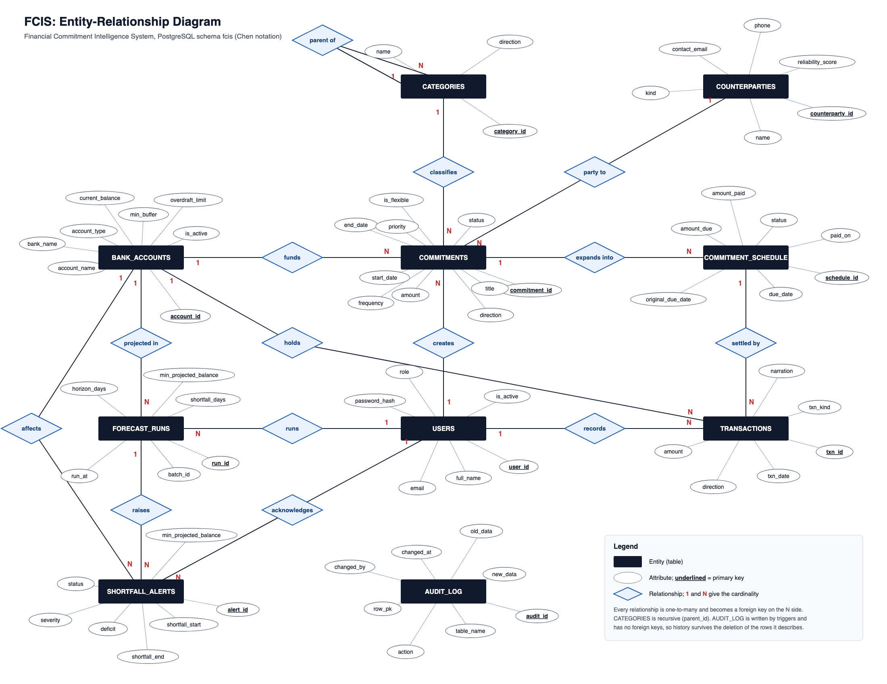{width=6.50in}


All relationships are one-to-many. `CATEGORIES` has a recursive relationship (a category has a parent category).
`COMMITMENT_SCHEDULE` depends on `COMMITMENTS` for its existence (ON DELETE CASCADE). `AUDIT_LOG` deliberately has
no foreign keys so that history survives the deletion of the rows it describes.

## 5.2 Relational schema

Primary keys are in **bold**; foreign keys are in *italics* with the table they reference.

- **users** (**user_id**, full_name, email, password_hash, role, is_active, created_at)
- **bank_accounts** (**account_id**, account_name, bank_name, account_last4, account_type, current_balance, min_buffer, overdraft_limit, is_active, created_at)
- **categories** (**category_id**, name, *parent_id* → categories, direction)
- **counterparties** (**counterparty_id**, name, kind, contact_email, phone, reliability_score)
- **commitments** (**commitment_id**, title, description, *category_id* → categories, *counterparty_id* → counterparties, *account_id* → bank_accounts, direction, amount, frequency, start_date, end_date, priority, is_flexible, status, *created_by* → users, created_at, search_doc)
- **commitment_schedule** (**schedule_id**, *commitment_id* → commitments, due_date, original_due_date, amount_due, amount_paid, status, paid_on)
- **transactions** (**txn_id**, *account_id* → bank_accounts, *schedule_id* → commitment_schedule, txn_date, direction, amount, narration, txn_kind, *recorded_by* → users, created_at)
- **forecast_runs** (**run_id**, batch_id, *account_id* → bank_accounts, *run_by* → users, run_at, horizon_days, opening_balance, threshold, min_projected_balance, min_balance_date, shortfall_days)
- **shortfall_alerts** (**alert_id**, *run_id* → forecast_runs, *account_id* → bank_accounts, shortfall_start, shortfall_end, min_projected_balance, deficit, severity, status, *acknowledged_by* → users, acknowledged_at, created_at)
- **audit_log** (**audit_id**, table_name, action, row_pk, changed_by, changed_at, old_data, new_data)

Candidate keys enforced with UNIQUE: users(email), bank_accounts(account_name), categories(name),
counterparties(name), commitments(title), commitment_schedule(commitment_id, original_due_date),
forecast_runs(batch_id, account_id).

**Normalisation.** Every table is in third normal form: each non-key attribute depends on the whole key and nothing
but the key. Category, counterparty and account details are held once and referenced by key. Two values are
derived and stored on purpose, and both are kept correct by triggers rather than by the application:
`bank_accounts.current_balance` (the sum of the ledger, checked by test Q05) and `commitment_schedule.status`
(derived from `amount_paid`, `amount_due` and `due_date`).

**Referential actions.** Deleting a commitment cascades to its instalments, but `transactions.schedule_id` is
ON DELETE RESTRICT, so a commitment with payment history cannot be deleted, only closed. Deleting a user sets
`created_by`, `recorded_by`, `run_by` and `acknowledged_by` to NULL so that financial history is never lost.

## 5.3 Data dictionary

Generated from the PostgreSQL catalogue.


### users

| Column | Type | Null | Default | Key |
|---|---|---|---|---|
| user_id | integer | NOT NULL | identity | PK |
| full_name | character varying(80) | NOT NULL |  |  |
| email | character varying(120) | NOT NULL |  | UNIQUE |
| password_hash | text | NOT NULL |  |  |
| role | character varying(10) | NOT NULL | 'viewer'::character varying |  |
| is_active | boolean | NOT NULL | true |  |
| created_at | timestamp with time zone | NOT NULL | now() |  |

CHECK constraints:

- `ck_users_email`: `CHECK (((email) ~* '^[A-Z0-9._%+-]+@[A-Z0-9.-]+\.[A-Z]{2,}$'))`
- `ck_users_name`: `CHECK ((length(btrim((full_name))) >= 2))`
- `ck_users_role`: `CHECK (((role) = ANY ((ARRAY['admin', 'analyst', 'viewer']))))`

### bank_accounts

| Column | Type | Null | Default | Key |
|---|---|---|---|---|
| account_id | integer | NOT NULL | identity | PK |
| account_name | character varying(60) | NOT NULL |  | UNIQUE |
| bank_name | character varying(80) | NOT NULL |  |  |
| account_last4 | character(4) | NOT NULL |  |  |
| account_type | character varying(10) | NOT NULL | 'current'::character varying |  |
| current_balance | numeric(14,2) | NOT NULL | 0 |  |
| min_buffer | numeric(14,2) | NOT NULL | 0 |  |
| overdraft_limit | numeric(14,2) | NOT NULL | 0 |  |
| is_active | boolean | NOT NULL | true |  |
| created_at | timestamp with time zone | NOT NULL | now() |  |

CHECK constraints:

- `ck_account_balance_floor`: `CHECK ((current_balance >= (- overdraft_limit)))`
- `ck_account_buffer`: `CHECK ((min_buffer >= (0)))`
- `ck_account_last4`: `CHECK ((account_last4 ~ '^[0-9]{4}$'))`
- `ck_account_od_limit`: `CHECK ((overdraft_limit >= (0)))`
- `ck_account_od_type`: `CHECK (((overdraft_limit = (0)) OR ((account_type) = 'overdraft')))`
- `ck_account_type`: `CHECK (((account_type) = ANY ((ARRAY['current', 'savings', 'overdraft']))))`

### categories

| Column | Type | Null | Default | Key |
|---|---|---|---|---|
| category_id | integer | NOT NULL | identity | PK |
| name | character varying(60) | NOT NULL |  | UNIQUE |
| parent_id | integer | NULL |  | FK -> fcis.categories |
| direction | character varying(7) | NOT NULL |  |  |

CHECK constraints:

- `ck_categories_dir`: `CHECK (((direction) = ANY ((ARRAY['inflow', 'outflow']))))`
- `ck_categories_self`: `CHECK (((parent_id IS NULL) OR (parent_id <> category_id)))`

### counterparties

| Column | Type | Null | Default | Key |
|---|---|---|---|---|
| counterparty_id | integer | NOT NULL | identity | PK |
| name | character varying(80) | NOT NULL |  | UNIQUE |
| kind | character varying(12) | NOT NULL |  |  |
| contact_email | character varying(120) | NULL |  |  |
| phone | character varying(15) | NULL |  |  |
| reliability_score | numeric(3,2) | NOT NULL | 1.00 |  |

CHECK constraints:

- `ck_counterparty_email`: `CHECK (((contact_email IS NULL) OR ((contact_email) ~* '^[A-Z0-9._%+-]+@[A-Z0-9.-]+\.[A-Z]{2,}$')))`
- `ck_counterparty_kind`: `CHECK (((kind) = ANY ((ARRAY['vendor', 'lender', 'customer', 'landlord', 'government', 'employees']))))`
- `ck_counterparty_phone`: `CHECK (((phone IS NULL) OR ((phone) ~ '^\+?[0-9]{10,14}$')))`
- `ck_counterparty_reliability`: `CHECK (((reliability_score >= (0)) AND (reliability_score <= (1))))`

### commitments

A recurring or one-off promise to pay (outflow) or to be paid (inflow).

| Column | Type | Null | Default | Key |
|---|---|---|---|---|
| commitment_id | integer | NOT NULL | identity | PK |
| title | character varying(120) | NOT NULL |  | UNIQUE |
| description | text | NULL |  |  |
| category_id | integer | NOT NULL |  | FK -> fcis.categories |
| counterparty_id | integer | NOT NULL |  | FK -> fcis.counterparties |
| account_id | integer | NOT NULL |  | FK -> fcis.bank_accounts |
| direction | character varying(7) | NOT NULL |  |  |
| amount | numeric(14,2) | NOT NULL |  |  |
| frequency | character varying(10) | NOT NULL |  |  |
| start_date | date | NOT NULL |  |  |
| end_date | date | NULL |  |  |
| priority | smallint | NOT NULL | 3 |  |
| is_flexible | boolean | NOT NULL | false |  |
| status | character varying(8) | NOT NULL | 'active'::character varying |  |
| created_by | integer | NULL |  | FK -> fcis.users |
| created_at | timestamp with time zone | NOT NULL | now() |  |
| search_doc | tsvector | NULL | generated |  |

CHECK constraints:

- `ck_commitments_amount`: `CHECK ((amount > (0)))`
- `ck_commitments_dates`: `CHECK (((end_date IS NULL) OR (end_date >= start_date)))`
- `ck_commitments_direction`: `CHECK (((direction) = ANY ((ARRAY['inflow', 'outflow']))))`
- `ck_commitments_frequency`: `CHECK (((frequency) = ANY ((ARRAY['once', 'weekly', 'monthly', 'quarterly', 'yearly']))))`
- `ck_commitments_priority`: `CHECK (((priority >= 1) AND (priority <= 5)))`
- `ck_commitments_status`: `CHECK (((status) = ANY ((ARRAY['active', 'paused', 'closed']))))`
- `ck_commitments_title`: `CHECK ((length(btrim((title))) >= 3))`

### commitment_schedule

Individual instalments of a commitment; generated by trigger from the recurrence rule.

| Column | Type | Null | Default | Key |
|---|---|---|---|---|
| schedule_id | bigint | NOT NULL | identity | PK |
| commitment_id | integer | NOT NULL |  | FK -> fcis.commitments, UNIQUE |
| due_date | date | NOT NULL |  |  |
| amount_due | numeric(14,2) | NOT NULL |  |  |
| amount_paid | numeric(14,2) | NOT NULL | 0 |  |
| status | character varying(8) | NOT NULL | 'pending'::character varying |  |
| paid_on | date | NULL |  |  |
| original_due_date | date | NOT NULL |  | UNIQUE |

CHECK constraints:

- `ck_schedule_amount_due`: `CHECK ((amount_due > (0)))`
- `ck_schedule_amount_paid`: `CHECK (((amount_paid >= (0)) AND (amount_paid <= amount_due)))`
- `ck_schedule_defer_forward`: `CHECK ((due_date >= original_due_date))`
- `ck_schedule_paid_full`: `CHECK ((((status) <> 'paid') OR (amount_paid = amount_due)))`
- `ck_schedule_status`: `CHECK (((status) = ANY ((ARRAY['pending', 'partial', 'paid', 'overdue', 'waived']))))`

### transactions

Immutable cash ledger. Triggers keep bank_accounts.current_balance in step.

| Column | Type | Null | Default | Key |
|---|---|---|---|---|
| txn_id | bigint | NOT NULL | identity | PK |
| account_id | integer | NOT NULL |  | FK -> fcis.bank_accounts |
| schedule_id | bigint | NULL |  | FK -> fcis.commitment_schedule |
| txn_date | date | NOT NULL | CURRENT_DATE |  |
| direction | character varying(6) | NOT NULL |  |  |
| amount | numeric(14,2) | NOT NULL |  |  |
| narration | character varying(200) | NOT NULL |  |  |
| recorded_by | integer | NULL |  | FK -> fcis.users |
| created_at | timestamp with time zone | NOT NULL | now() |  |
| txn_kind | character varying(10) | NOT NULL | 'manual'::character varying |  |

CHECK constraints:

- `ck_transactions_amount`: `CHECK ((amount > (0)))`
- `ck_transactions_dir`: `CHECK (((direction) = ANY ((ARRAY['credit', 'debit']))))`
- `ck_transactions_kind`: `CHECK (((txn_kind) = ANY ((ARRAY['commitment', 'manual', 'transfer', 'opening']))))`
- `ck_transactions_kind_link`: `CHECK ((((txn_kind) = 'commitment') = (schedule_id IS NOT NULL)))`
- `ck_transactions_narr`: `CHECK ((length(btrim((narration))) >= 3))`

### forecast_runs

| Column | Type | Null | Default | Key |
|---|---|---|---|---|
| run_id | bigint | NOT NULL | identity | PK |
| batch_id | bigint | NOT NULL |  | UNIQUE |
| account_id | integer | NOT NULL |  | FK -> fcis.bank_accounts, UNIQUE |
| run_by | integer | NULL |  | FK -> fcis.users |
| run_at | timestamp with time zone | NOT NULL | now() |  |
| horizon_days | integer | NOT NULL |  |  |
| opening_balance | numeric(14,2) | NOT NULL |  |  |
| threshold | numeric(14,2) | NOT NULL |  |  |
| min_projected_balance | numeric(14,2) | NOT NULL |  |  |
| min_balance_date | date | NOT NULL |  |  |
| shortfall_days | integer | NOT NULL | 0 |  |

CHECK constraints:

- `ck_forecast_horizon`: `CHECK (((horizon_days >= 7) AND (horizon_days <= 365)))`
- `ck_forecast_short_days`: `CHECK ((shortfall_days >= 0))`

### shortfall_alerts

Continuous periods where the projected balance falls below the account threshold.

| Column | Type | Null | Default | Key |
|---|---|---|---|---|
| alert_id | bigint | NOT NULL | identity | PK |
| run_id | bigint | NOT NULL |  | FK -> fcis.forecast_runs |
| account_id | integer | NOT NULL |  | FK -> fcis.bank_accounts |
| shortfall_start | date | NOT NULL |  |  |
| shortfall_end | date | NOT NULL |  |  |
| min_projected_balance | numeric(14,2) | NOT NULL |  |  |
| deficit | numeric(14,2) | NOT NULL |  |  |
| severity | character varying(8) | NOT NULL |  |  |
| status | character varying(12) | NOT NULL | 'open'::character varying |  |
| acknowledged_by | integer | NULL |  | FK -> fcis.users |
| acknowledged_at | timestamp with time zone | NULL |  |  |
| created_at | timestamp with time zone | NOT NULL | now() |  |

CHECK constraints:

- `ck_alerts_ack`: `CHECK ((((status) <> 'acknowledged') OR (acknowledged_at IS NOT NULL)))`
- `ck_alerts_deficit`: `CHECK ((deficit > (0)))`
- `ck_alerts_period`: `CHECK ((shortfall_end >= shortfall_start))`
- `ck_alerts_severity`: `CHECK (((severity) = ANY ((ARRAY['low', 'medium', 'high', 'critical']))))`
- `ck_alerts_status`: `CHECK (((status) = ANY ((ARRAY['open', 'acknowledged', 'resolved', 'superseded']))))`

### audit_log

| Column | Type | Null | Default | Key |
|---|---|---|---|---|
| audit_id | bigint | NOT NULL | identity | PK |
| table_name | character varying(40) | NOT NULL |  |  |
| action | character varying(6) | NOT NULL |  |  |
| row_pk | text | NOT NULL |  |  |
| changed_by | integer | NULL |  |  |
| changed_at | timestamp with time zone | NOT NULL | now() |  |
| old_data | jsonb | NULL |  |  |
| new_data | jsonb | NULL |  |  |

CHECK constraints:

- `ck_audit_action`: `CHECK (((action) = ANY ((ARRAY['INSERT', 'UPDATE', 'DELETE']))))`


## 5.4 MongoDB data model

| Collection | One document is | Linked to PostgreSQL by | Indexes |
|---|---|---|---|
| `commitment_notes` | a note on a commitment: title, body, tags, free-form `terms`, author, pinned flag, timestamps | `commitmentId` | `by_commitment` (compound), `by_tag` (multikey), `notes_text` (weighted text: title 5, tags 3, body 1) |
| `forecast_snapshots` | the forecast of one account in one run: a `summary`, a `daily` array (date, inflow, outflow, balance, shortfall flag, and the `items` due that day), and an `annotations` array | `runId`, `accountId`, `batchId` | `run_unique` (unique), `latest_per_account` (compound), `runs_with_shortfall` (partial) |
| `activity_events` | one user action: type, actor, time, and a payload whose shape depends on the type | `actor.userId` | `ttl_180_days` (TTL), `by_type`, `by_actor` |

Every collection has a `$jsonSchema` validator with `validationLevel: strict` and `validationAction: error`, so the
required fields, types, tag pattern, array limits and the list of event types are enforced by MongoDB itself.


A `commitment_notes` document from the demo database:

```json
{
  "commitmentId": 18,
  "title": "Lease renewal terms",
  "body": "Lease renewed for 3 years. Rent escalates 5% every April. Landlord allows a 3-day grace period; after that a late fee of 2% per month applies. Security deposit of 10 months is held and is refundable.",
  "tags": [
    "lease",
    "escalation",
    "grace-period"
  ],
  "terms": {
    "graceDays": 3,
    "lateFeePercentPerMonth": 2,
    "escalationPercent": 5,
    "escalationMonth": "April",
    "securityDepositMonths": 10,
    "lockInMonths": 18
  },
  "author": {
    "userId": 2,
    "name": "Rohan Iyer"
  },
  "pinned": true,
  "createdAt": {
    "$date": "2026-11-01T23:41:22.762Z"
  },
  "updatedAt": {
    "$date": "2026-11-01T23:41:22.762Z"
  }
}
```

A `forecast_snapshots` document from the demo database. The `daily` array holds one element per day of the horizon; only the first shortfall day is shown here.

```json
{
  "batchId": 1,
  "runId": 1,
  "accountId": 1,
  "accountName": "Operating Account",
  "generatedAt": {
    "$date": "2026-11-15T11:41:22.330Z"
  },
  "generatedBy": {
    "userId": 2,
    "name": "Rohan Iyer"
  },
  "horizonDays": 60,
  "openingBalance": 520000,
  "threshold": 300000,
  "summary": {
    "minBalance": -158600,
    "minBalanceDate": {
      "$date": "2026-12-05T00:00:00Z"
    },
    "shortfallDays": 17,
    "firstShortfallDate": {
      "$date": "2026-11-28T00:00:00Z"
    },
    "totalInflow": 5258200,
    "totalOutflow": 4647000
  },
  "daily": [
    {
      "date": {
        "$date": "2026-11-28T00:00:00Z"
      },
      "inflow": 0,
      "outflow": 950000,
      "balance": 30600,
      "shortfall": true,
      "items": [
        {
          "scheduleId": 329,
          "commitmentId": 15,
          "title": "Staff salaries",
          "counterparty": "Staff Payroll",
          "direction": "outflow",
          "amount": 950000,
          "priority": 1,
          "flexible": false,
          "status": "pending"
        }
      ]
    }
  ],
  "annotations": [],
  "pinned": false
}
```


**Retrieval strategy.** Notes are fetched by `commitmentId` (compound index, pinned first), by tag (multikey
index) or by `$text` search ranked with `textScore`. The dashboard needs the newest snapshot of each account, which
is a `$sort` + `$group` + `$first` over the `latest_per_account` index. Snapshot lists exclude the heavy `daily`
array with a projection. Analytics `$unwind` the `daily` array (and the `items` inside it) and `$group` by week or by
commitment.

# 6. SQL database commands

All SQL is in `db/sql/`. The files run in order through `npm run db:setup`.

## 6.1 DDL: CREATE, ALTER, DROP, keys, constraints, indexes (`01_schema.sql`)


```sql
-- =====================================================================
-- FCIS : Financial Commitment Intelligence System
-- 01_schema.sql  -  DDL: CREATE / ALTER / DROP, keys, constraints, indexes
-- Target: PostgreSQL 15+
-- =====================================================================

DROP SCHEMA IF EXISTS fcis CASCADE;
CREATE SCHEMA fcis;
SET search_path = fcis, public;

CREATE EXTENSION IF NOT EXISTS pgcrypto WITH SCHEMA public;   -- crypt() / gen_salt() for password hashing

-- ---------------------------------------------------------------------
-- 1. USERS  (application users; role drives the PostgreSQL role used)
-- ---------------------------------------------------------------------
CREATE TABLE users (
    user_id        INT GENERATED ALWAYS AS IDENTITY,
    full_name      VARCHAR(80)  NOT NULL,
    email          VARCHAR(120) NOT NULL,
    password_hash  TEXT         NOT NULL,
    role           VARCHAR(10)  NOT NULL DEFAULT 'viewer',
    is_active      BOOLEAN      NOT NULL DEFAULT TRUE,
    created_at     TIMESTAMPTZ  NOT NULL DEFAULT now(),
    CONSTRAINT pk_users        PRIMARY KEY (user_id),
    CONSTRAINT uq_users_email  UNIQUE (email),
    CONSTRAINT ck_users_name   CHECK (length(btrim(full_name)) >= 2),
    CONSTRAINT ck_users_email  CHECK (email ~* '^[A-Z0-9._%+-]+@[A-Z0-9.-]+\.[A-Z]{2,}$'),
    CONSTRAINT ck_users_role   CHECK (role IN ('admin', 'analyst', 'viewer'))
);

-- ---------------------------------------------------------------------
-- 2. BANK_ACCOUNTS  (where cash sits; balance is maintained by trigger)
-- ---------------------------------------------------------------------
CREATE TABLE bank_accounts (
    account_id       INT GENERATED ALWAYS AS IDENTITY,
    account_name     VARCHAR(60)   NOT NULL,
    bank_name        VARCHAR(60)   NOT NULL,
    account_last4    CHAR(4)       NOT NULL,
    account_type     VARCHAR(10)   NOT NULL DEFAULT 'current',
    current_balance  NUMERIC(14,2) NOT NULL DEFAULT 0,
    min_buffer       NUMERIC(14,2) NOT NULL DEFAULT 0,
    overdraft_limit  NUMERIC(14,2) NOT NULL DEFAULT 0,
    is_active        BOOLEAN       NOT NULL DEFAULT TRUE,
    created_at       TIMESTAMPTZ   NOT NULL DEFAULT now(),
    CONSTRAINT pk_bank_accounts      PRIMARY KEY (account_id),
    CONSTRAINT uq_bank_accounts_name UNIQUE (account_name),
    CONSTRAINT ck_account_last4      CHECK (account_last4 ~ '^[0-9]{4}$'),
    CONSTRAINT ck_account_type       CHECK (account_type IN ('current', 'savings', 'overdraft')),
    CONSTRAINT ck_account_buffer     CHECK (min_buffer >= 0),
    CONSTRAINT ck_account_od_limit   CHECK (overdraft_limit >= 0),
    CONSTRAINT ck_account_od_type    CHECK (overdraft_limit = 0 OR account_type = 'overdraft'),
    -- the balance may never go below what the bank allows
    CONSTRAINT ck_account_balance_floor CHECK (current_balance >= -overdraft_limit)
);

-- ---------------------------------------------------------------------
-- 3. CATEGORIES  (self-referencing hierarchy -> recursive CTE roll-ups)
-- ---------------------------------------------------------------------
CREATE TABLE categories (
    category_id  INT GENERATED ALWAYS AS IDENTITY,
    name         VARCHAR(60) NOT NULL,
    parent_id    INT,
    direction    VARCHAR(7)  NOT NULL,
    CONSTRAINT pk_categories        PRIMARY KEY (category_id),
    CONSTRAINT uq_categories_name   UNIQUE (name),
    CONSTRAINT fk_categories_parent FOREIGN KEY (parent_id)
        REFERENCES categories (category_id) ON DELETE RESTRICT,
    CONSTRAINT ck_categories_dir    CHECK (direction IN ('inflow', 'outflow')),
    CONSTRAINT ck_categories_self   CHECK (parent_id IS NULL OR parent_id <> category_id)
);

-- ---------------------------------------------------------------------
-- 4. COUNTERPARTIES  (who we owe / who owes us)
-- ---------------------------------------------------------------------
CREATE TABLE counterparties (
    counterparty_id  INT GENERATED ALWAYS AS IDENTITY,
    name             VARCHAR(80) NOT NULL,
    kind             VARCHAR(12) NOT NULL,
    contact_email    VARCHAR(120),
    phone            VARCHAR(15),
    CONSTRAINT pk_counterparties      PRIMARY KEY (counterparty_id),
    CONSTRAINT uq_counterparties_name UNIQUE (name),
    CONSTRAINT ck_counterparty_kind   CHECK (kind IN ('vendor', 'lender', 'customer', 'landlord', 'government', 'employees')),
    CONSTRAINT ck_counterparty_email  CHECK (contact_email IS NULL OR contact_email ~* '^[A-Z0-9._%+-]+@[A-Z0-9.-]+\.[A-Z]{2,}$'),
    CONSTRAINT ck_counterparty_phone  CHECK (phone IS NULL OR phone ~ '^\+?[0-9]{10,14}$')
);

-- ---------------------------------------------------------------------
-- 5. COMMITMENTS  (a recurring or one-off promise to pay or be paid)
-- ---------------------------------------------------------------------
CREATE TABLE commitments (
    commitment_id    INT GENERATED ALWAYS AS IDENTITY,
    title            VARCHAR(120)  NOT NULL,
    description      TEXT,
    category_id      INT           NOT NULL,
    counterparty_id  INT           NOT NULL,
    account_id       INT           NOT NULL,
    direction        VARCHAR(7)    NOT NULL,
    amount           NUMERIC(14,2) NOT NULL,
    frequency        VARCHAR(10)   NOT NULL,
    start_date       DATE          NOT NULL,
    end_date         DATE,
    priority         SMALLINT      NOT NULL DEFAULT 3,   -- 1 = critical ... 5 = discretionary
    is_flexible      BOOLEAN       NOT NULL DEFAULT FALSE, -- can a due date be negotiated?
    status           VARCHAR(8)    NOT NULL DEFAULT 'active',
    created_by       INT,
    created_at       TIMESTAMPTZ   NOT NULL DEFAULT now(),
    CONSTRAINT pk_commitments           PRIMARY KEY (commitment_id),
    CONSTRAINT uq_commitments_title     UNIQUE (title),
    CONSTRAINT fk_commitments_category  FOREIGN KEY (category_id)
        REFERENCES categories (category_id) ON DELETE RESTRICT,
    CONSTRAINT fk_commitments_cparty    FOREIGN KEY (counterparty_id)
        REFERENCES counterparties (counterparty_id) ON DELETE RESTRICT,
    CONSTRAINT fk_commitments_account   FOREIGN KEY (account_id)
        REFERENCES bank_accounts (account_id) ON DELETE RESTRICT,
    CONSTRAINT fk_commitments_creator   FOREIGN KEY (created_by)
        REFERENCES users (user_id) ON DELETE SET NULL,
    CONSTRAINT ck_commitments_title     CHECK (length(btrim(title)) >= 3),
    CONSTRAINT ck_commitments_direction CHECK (direction IN ('inflow', 'outflow')),
    CONSTRAINT ck_commitments_amount    CHECK (amount > 0),
    CONSTRAINT ck_commitments_frequency CHECK (frequency IN ('once', 'weekly', 'monthly', 'quarterly', 'yearly')),
    CONSTRAINT ck_commitments_dates     CHECK (end_date IS NULL OR end_date >= start_date),
    CONSTRAINT ck_commitments_priority  CHECK (priority BETWEEN 1 AND 5),
    CONSTRAINT ck_commitments_status    CHECK (status IN ('active', 'paused', 'closed'))
);

-- ---------------------------------------------------------------------
-- 6. COMMITMENT_SCHEDULE  (one row per due date; generated by trigger)
-- ---------------------------------------------------------------------
CREATE TABLE commitment_schedule (
    schedule_id    BIGINT GENERATED ALWAYS AS IDENTITY,
    commitment_id  INT           NOT NULL,
    due_date       DATE          NOT NULL,
    amount_due     NUMERIC(14,2) NOT NULL,
    amount_paid    NUMERIC(14,2) NOT NULL DEFAULT 0,
    status         VARCHAR(8)    NOT NULL DEFAULT 'pending',
    paid_on        DATE,
    CONSTRAINT pk_schedule             PRIMARY KEY (schedule_id),
    CONSTRAINT fk_schedule_commitment  FOREIGN KEY (commitment_id)
        REFERENCES commitments (commitment_id) ON DELETE CASCADE,
    CONSTRAINT uq_schedule_commitment_due UNIQUE (commitment_id, due_date),
    CONSTRAINT ck_schedule_amount_due  CHECK (amount_due > 0),
    CONSTRAINT ck_schedule_amount_paid CHECK (amount_paid >= 0 AND amount_paid <= amount_due),
    CONSTRAINT ck_schedule_status      CHECK (status IN ('pending', 'partial', 'paid', 'overdue', 'waived')),
    CONSTRAINT ck_schedule_paid_full   CHECK (status <> 'paid' OR amount_paid = amount_due)
);

-- ---------------------------------------------------------------------
-- 7. TRANSACTIONS  (immutable ledger; every row moves an account balance)
-- ---------------------------------------------------------------------
CREATE TABLE transactions (
    txn_id       BIGINT GENERATED ALWAYS AS IDENTITY,
    account_id   INT           NOT NULL,
    schedule_id  BIGINT,
    txn_date     DATE          NOT NULL DEFAULT CURRENT_DATE,
    direction    VARCHAR(6)    NOT NULL,
    amount       NUMERIC(14,2) NOT NULL,
    narration    VARCHAR(200)  NOT NULL,
    recorded_by  INT,
    created_at   TIMESTAMPTZ   NOT NULL DEFAULT now(),
    CONSTRAINT pk_transactions         PRIMARY KEY (txn_id),
    CONSTRAINT fk_transactions_account FOREIGN KEY (account_id)
        REFERENCES bank_accounts (account_id) ON DELETE RESTRICT,
    CONSTRAINT fk_transactions_user    FOREIGN KEY (recorded_by)
        REFERENCES users (user_id) ON DELETE SET NULL,
    CONSTRAINT ck_transactions_dir     CHECK (direction IN ('credit', 'debit')),
    CONSTRAINT ck_transactions_amount  CHECK (amount > 0),
    CONSTRAINT ck_transactions_narr    CHECK (length(btrim(narration)) >= 3)
);

-- ---------------------------------------------------------------------
-- 8. FORECAST_RUNS  (one row per account per forecast batch)
-- ---------------------------------------------------------------------
CREATE SEQUENCE forecast_batch_seq START 1;

CREATE TABLE forecast_runs (
    run_id                 BIGINT GENERATED ALWAYS AS IDENTITY,
    batch_id               BIGINT        NOT NULL,
    account_id             INT           NOT NULL,
    run_by                 INT,
    run_at                 TIMESTAMPTZ   NOT NULL DEFAULT now(),
    horizon_days           INT           NOT NULL,
    opening_balance        NUMERIC(14,2) NOT NULL,
    threshold              NUMERIC(14,2) NOT NULL,
    min_projected_balance  NUMERIC(14,2) NOT NULL,
    min_balance_date       DATE          NOT NULL,
    shortfall_days         INT           NOT NULL DEFAULT 0,
    CONSTRAINT pk_forecast_runs         PRIMARY KEY (run_id),
    CONSTRAINT uq_forecast_batch_acct   UNIQUE (batch_id, account_id),
    CONSTRAINT fk_forecast_runs_account FOREIGN KEY (account_id)
        REFERENCES bank_accounts (account_id) ON DELETE CASCADE,
    CONSTRAINT fk_forecast_runs_user    FOREIGN KEY (run_by)
        REFERENCES users (user_id) ON DELETE SET NULL,
    CONSTRAINT ck_forecast_horizon      CHECK (horizon_days BETWEEN 7 AND 365),
    CONSTRAINT ck_forecast_short_days   CHECK (shortfall_days >= 0)
);

-- ---------------------------------------------------------------------
-- 9. SHORTFALL_ALERTS  (one row per continuous shortfall episode)
-- ---------------------------------------------------------------------
CREATE TABLE shortfall_alerts (
    alert_id               BIGINT GENERATED ALWAYS AS IDENTITY,
    run_id                 BIGINT        NOT NULL,
    account_id             INT           NOT NULL,
    shortfall_start        DATE          NOT NULL,
    shortfall_end          DATE          NOT NULL,
    min_projected_balance  NUMERIC(14,2) NOT NULL,
    deficit                NUMERIC(14,2) NOT NULL,
    severity               VARCHAR(8)    NOT NULL,
    status                 VARCHAR(12)   NOT NULL DEFAULT 'open',
    acknowledged_by        INT,
    acknowledged_at        TIMESTAMPTZ,
    created_at             TIMESTAMPTZ   NOT NULL DEFAULT now(),
    CONSTRAINT pk_shortfall_alerts   PRIMARY KEY (alert_id),
    CONSTRAINT fk_alerts_run         FOREIGN KEY (run_id)
        REFERENCES forecast_runs (run_id) ON DELETE CASCADE,
    CONSTRAINT fk_alerts_account     FOREIGN KEY (account_id)
        REFERENCES bank_accounts (account_id) ON DELETE CASCADE,
    CONSTRAINT fk_alerts_ack_user    FOREIGN KEY (acknowledged_by)
        REFERENCES users (user_id) ON DELETE SET NULL,
    CONSTRAINT ck_alerts_period      CHECK (shortfall_end >= shortfall_start),
    CONSTRAINT ck_alerts_deficit     CHECK (deficit > 0),
    CONSTRAINT ck_alerts_severity    CHECK (severity IN ('low', 'medium', 'high', 'critical')),
    CONSTRAINT ck_alerts_status      CHECK (status IN ('open', 'acknowledged', 'resolved', 'superseded')),
    CONSTRAINT ck_alerts_ack         CHECK (status <> 'acknowledged' OR acknowledged_at IS NOT NULL)
);

-- ---------------------------------------------------------------------
-- 10. AUDIT_LOG  (written only by triggers)
-- ---------------------------------------------------------------------
CREATE TABLE audit_log (
    audit_id    BIGINT GENERATED ALWAYS AS IDENTITY,
    table_name  VARCHAR(40) NOT NULL,
    action      VARCHAR(6)  NOT NULL,
    row_pk      TEXT        NOT NULL,
    changed_by  INT,                       -- deliberately not a FK: history must survive user deletion
    changed_at  TIMESTAMPTZ NOT NULL DEFAULT now(),
    old_data    JSONB,
    new_data    JSONB,
    CONSTRAINT pk_audit_log    PRIMARY KEY (audit_id),
    CONSTRAINT ck_audit_action CHECK (action IN ('INSERT', 'UPDATE', 'DELETE'))
);

-- =====================================================================
-- ALTER TABLE : schema evolution after the first design review
-- =====================================================================

-- (a) Customers do not always pay on time. A reliability score (0..1)
--     lets the forecast discount inflows we are not sure of.
ALTER TABLE counterparties
    ADD COLUMN reliability_score NUMERIC(3,2) NOT NULL DEFAULT 1.00;
ALTER TABLE counterparties
    ADD CONSTRAINT ck_counterparty_reliability CHECK (reliability_score BETWEEN 0 AND 1);

-- (b) Deferring a due date must not lose the date originally agreed.
ALTER TABLE commitment_schedule ADD COLUMN original_due_date DATE;
UPDATE commitment_schedule SET original_due_date = due_date;
ALTER TABLE commitment_schedule ALTER COLUMN original_due_date SET NOT NULL;
--     Uniqueness now belongs to the original date, so two instalments of
--     one commitment may be deferred to the same day.
ALTER TABLE commitment_schedule DROP CONSTRAINT uq_schedule_commitment_due;
ALTER TABLE commitment_schedule
    ADD CONSTRAINT uq_schedule_commitment_original UNIQUE (commitment_id, original_due_date);
ALTER TABLE commitment_schedule
    ADD CONSTRAINT ck_schedule_defer_forward CHECK (due_date >= original_due_date);

-- (c) The ledger needs to tell commitment payments from transfers and
--     opening balances, and to point back at the instalment it settled.
ALTER TABLE transactions
    ADD COLUMN txn_kind VARCHAR(10) NOT NULL DEFAULT 'manual';
ALTER TABLE transactions
    ADD CONSTRAINT ck_transactions_kind CHECK (txn_kind IN ('commitment', 'manual', 'transfer', 'opening'));
ALTER TABLE transactions
    ADD CONSTRAINT fk_transactions_schedule FOREIGN KEY (schedule_id)
        REFERENCES commitment_schedule (schedule_id) ON DELETE RESTRICT;
ALTER TABLE transactions
    ADD CONSTRAINT ck_transactions_kind_link
        CHECK ((txn_kind = 'commitment') = (schedule_id IS NOT NULL));

-- (d) Full-text search document for commitments (generated column).
ALTER TABLE commitments
    ADD COLUMN search_doc tsvector
    GENERATED ALWAYS AS (
        setweight(to_tsvector('english', title), 'A') ||
        setweight(to_tsvector('english', coalesce(description, '')), 'B')
    ) STORED;

-- (e) Widen a column that proved too short for real bank names.
ALTER TABLE bank_accounts ALTER COLUMN bank_name TYPE VARCHAR(80);

-- =====================================================================
-- INDEXES
-- =====================================================================
CREATE INDEX idx_commitments_account_status ON commitments (account_id, status);
CREATE INDEX idx_commitments_category       ON commitments (category_id);
CREATE INDEX idx_commitments_counterparty   ON commitments (counterparty_id);
CREATE INDEX idx_commitments_search         ON commitments USING GIN (search_doc);      -- full-text
CREATE INDEX idx_categories_parent          ON categories (parent_id);

CREATE INDEX idx_schedule_due_all           ON commitment_schedule (due_date);
-- partial index: the forecast only ever scans unsettled instalments
CREATE INDEX idx_schedule_open_due          ON commitment_schedule (due_date, commitment_id)
    WHERE status IN ('pending', 'partial', 'overdue');

CREATE INDEX idx_transactions_account_date  ON transactions (account_id, txn_date DESC);
CREATE INDEX idx_transactions_schedule      ON transactions (schedule_id) WHERE schedule_id IS NOT NULL;
CREATE INDEX idx_transactions_narration_fts ON transactions USING GIN (to_tsvector('english', narration));

CREATE INDEX idx_alerts_live                ON shortfall_alerts (account_id, shortfall_start)
    WHERE status IN ('open', 'acknowledged');
CREATE INDEX idx_forecast_runs_account_time ON forecast_runs (account_id, run_at DESC);
CREATE INDEX idx_audit_table_time           ON audit_log (table_name, changed_at DESC);

-- =====================================================================
-- DROP : remove objects that are no longer needed
-- =====================================================================

-- idx_schedule_due_all is fully covered by the partial index above for
-- every query the application runs, so it only costs write time.
DROP INDEX IF EXISTS idx_schedule_due_all;

-- Staging table used once to load the legacy spreadsheet of commitments.
CREATE TABLE stg_legacy_commitments (
    raw_title   TEXT,
    raw_amount  TEXT,
    raw_due     TEXT
);
DROP TABLE IF EXISTS stg_legacy_commitments;

-- =====================================================================
-- Catalogue comments (appear in \d+ and in the data dictionary)
-- =====================================================================
COMMENT ON TABLE  commitments              IS 'A recurring or one-off promise to pay (outflow) or to be paid (inflow).';
COMMENT ON TABLE  commitment_schedule      IS 'Individual instalments of a commitment; generated by trigger from the recurrence rule.';
COMMENT ON TABLE  transactions             IS 'Immutable cash ledger. Triggers keep bank_accounts.current_balance in step.';
COMMENT ON TABLE  shortfall_alerts         IS 'Continuous periods where the projected balance falls below the account threshold.';
COMMENT ON COLUMN counterparties.reliability_score IS 'Probability weight applied to inflows expected from this party (0 to 1).';
COMMENT ON COLUMN commitments.priority     IS '1 = critical (statutory, payroll) ... 5 = discretionary.';
COMMENT ON COLUMN commitments.is_flexible  IS 'TRUE when the due date can be negotiated; only flexible items are offered for deferral.';
```


Indexes present after setup:

| Table | Index | Definition |
|---|---|---|
| audit_log | idx_audit_table_time | `btree (table_name, changed_at DESC)` |
| categories | idx_categories_parent | `btree (parent_id)` |
| commitment_schedule | idx_schedule_open_due | `btree (due_date, commitment_id) WHERE ((status)::text = ANY ((ARRAY['pending'::character varying, 'partial'::character varying, 'overdue'::character varying])::text[]))` |
| commitments | idx_commitments_account_status | `btree (account_id, status)` |
| commitments | idx_commitments_category | `btree (category_id)` |
| commitments | idx_commitments_counterparty | `btree (counterparty_id)` |
| commitments | idx_commitments_search | `gin (search_doc)` |
| forecast_runs | idx_forecast_runs_account_time | `btree (account_id, run_at DESC)` |
| shortfall_alerts | idx_alerts_live | `btree (account_id, shortfall_start) WHERE ((status)::text = ANY ((ARRAY['open'::character varying, 'acknowledged'::character varying])::text[]))` |
| transactions | idx_transactions_account_date | `btree (account_id, txn_date DESC)` |
| transactions | idx_transactions_narration_fts | `gin (to_tsvector('english'::regconfig, (narration)::text))` |
| transactions | idx_transactions_schedule | `btree (schedule_id) WHERE (schedule_id IS NOT NULL)` |


## 6.2 Functions and stored procedures (`02_functions_procedures.sql`)


```sql
-- =====================================================================
-- FCIS  02_functions_procedures.sql
-- Stored functions and procedures (PL/pgSQL and SQL)
-- =====================================================================
SET search_path = fcis, public;

-- ---------------------------------------------------------------------
-- fn_app_user : id of the application user behind the current request.
-- The API sets it per transaction with set_config('app.user_id', ...).
-- ---------------------------------------------------------------------
CREATE OR REPLACE FUNCTION fn_app_user() RETURNS INT
LANGUAGE sql STABLE AS $$
    SELECT NULLIF(current_setting('app.user_id', TRUE), '')::INT
$$;

-- ---------------------------------------------------------------------
-- fn_nth_due_date : n-th occurrence of a recurrence, counted from the
-- start date (so 31 Jan + 1 month = 28 Feb, + 2 months = 31 Mar).
-- ---------------------------------------------------------------------
CREATE OR REPLACE FUNCTION fn_nth_due_date(p_start DATE, p_frequency TEXT, p_n INT)
RETURNS DATE
LANGUAGE sql IMMUTABLE AS $$
    SELECT CASE p_frequency
        WHEN 'once'      THEN p_start
        WHEN 'weekly'    THEN p_start + 7 * p_n
        WHEN 'monthly'   THEN (p_start + make_interval(months => p_n))::DATE
        WHEN 'quarterly' THEN (p_start + make_interval(months => 3 * p_n))::DATE
        WHEN 'yearly'    THEN (p_start + make_interval(years  => p_n))::DATE
    END
$$;

-- ---------------------------------------------------------------------
-- fn_alert_severity : how urgent is a shortfall?
-- ---------------------------------------------------------------------
CREATE OR REPLACE FUNCTION fn_alert_severity(p_start DATE, p_min_balance NUMERIC, p_floor NUMERIC)
RETURNS TEXT
LANGUAGE sql STABLE AS $$
    SELECT CASE
        WHEN p_min_balance < p_floor AND p_start - CURRENT_DATE <= 14 THEN 'critical'  -- account would bounce payments soon
        WHEN p_min_balance < p_floor OR  p_start - CURRENT_DATE <= 7  THEN 'high'
        WHEN p_start - CURRENT_DATE <= 30                             THEN 'medium'
        ELSE 'low'
    END
$$;

-- ---------------------------------------------------------------------
-- sp_generate_schedule : expand a commitment's recurrence rule into
-- instalment rows up to p_until. Safe to call repeatedly.
-- ---------------------------------------------------------------------
CREATE OR REPLACE PROCEDURE sp_generate_schedule(
    p_commitment_id INT,
    p_until         DATE DEFAULT (CURRENT_DATE + 365)
)
LANGUAGE plpgsql SECURITY DEFINER SET search_path = fcis, public AS $$
DECLARE
    c       commitments%ROWTYPE;
    v_last  DATE;
    v_due   DATE;
    n       INT := 0;
BEGIN
    SELECT * INTO c FROM commitments WHERE commitment_id = p_commitment_id;
    IF NOT FOUND THEN
        RAISE EXCEPTION 'Commitment % does not exist', p_commitment_id;
    END IF;

    v_last := LEAST(COALESCE(c.end_date, p_until), p_until);

    LOOP
        v_due := fn_nth_due_date(c.start_date, c.frequency, n);
        EXIT WHEN v_due > v_last;

        INSERT INTO commitment_schedule (commitment_id, due_date, original_due_date, amount_due)
        VALUES (c.commitment_id, v_due, v_due, c.amount)
        ON CONFLICT (commitment_id, original_due_date) DO NOTHING;

        EXIT WHEN c.frequency = 'once';
        n := n + 1;
    END LOOP;
END;
$$;

-- ---------------------------------------------------------------------
-- sp_mark_overdue : flag instalments whose due date has passed.
-- ---------------------------------------------------------------------
CREATE OR REPLACE PROCEDURE sp_mark_overdue()
LANGUAGE sql SECURITY DEFINER SET search_path = fcis, public AS $$
    UPDATE commitment_schedule
       SET status = 'overdue'
     WHERE status = 'pending'
       AND due_date < CURRENT_DATE;
$$;

-- ---------------------------------------------------------------------
-- sp_post_transaction : a manual ledger entry (deposit, bank charge ...)
-- ---------------------------------------------------------------------
CREATE OR REPLACE PROCEDURE sp_post_transaction(
    p_account_id INT,
    p_direction  TEXT,
    p_amount     NUMERIC,
    p_narration  TEXT,
    p_txn_date   DATE DEFAULT CURRENT_DATE,
    p_kind       TEXT DEFAULT 'manual'
)
LANGUAGE plpgsql SECURITY DEFINER SET search_path = fcis, public AS $$
DECLARE
    v_balance NUMERIC;
    v_limit   NUMERIC;
    v_name    TEXT;
BEGIN
    IF p_kind NOT IN ('manual', 'opening') THEN
        RAISE EXCEPTION 'Only manual and opening entries can be posted directly';
    END IF;
    IF p_txn_date > CURRENT_DATE THEN
        RAISE EXCEPTION 'A transaction cannot be dated in the future (%)', p_txn_date;
    END IF;

    SELECT current_balance, overdraft_limit, account_name
      INTO v_balance, v_limit, v_name
      FROM bank_accounts WHERE account_id = p_account_id FOR UPDATE;
    IF NOT FOUND THEN
        RAISE EXCEPTION 'Account % does not exist', p_account_id;
    END IF;
    IF p_direction = 'debit' AND v_balance + v_limit < p_amount THEN
        RAISE EXCEPTION 'Insufficient funds in %: available %, required %',
            v_name, to_char(v_balance + v_limit, 'FM99,99,99,990.00'), to_char(p_amount, 'FM99,99,99,990.00');
    END IF;

    INSERT INTO transactions (account_id, txn_date, direction, amount, narration, recorded_by, txn_kind)
    VALUES (p_account_id, p_txn_date, p_direction, p_amount, p_narration, fn_app_user(), p_kind);
END;
$$;

-- ---------------------------------------------------------------------
-- sp_record_payment : settle (fully or partly) one instalment.
-- Runs inside the caller's transaction: the ledger insert, the balance
-- update (trigger) and the instalment update succeed or fail together.
-- ---------------------------------------------------------------------
CREATE OR REPLACE PROCEDURE sp_record_payment(
    p_schedule_id BIGINT,
    p_amount      NUMERIC,
    p_txn_date    DATE DEFAULT CURRENT_DATE,
    p_narration   TEXT DEFAULT NULL
)
LANGUAGE plpgsql SECURITY DEFINER SET search_path = fcis, public AS $$
DECLARE
    s            commitment_schedule%ROWTYPE;
    c            commitments%ROWTYPE;
    v_balance    NUMERIC;
    v_limit      NUMERIC;
    v_acct_name  TEXT;
    v_remaining  NUMERIC;
BEGIN
    -- lock the instalment so two users cannot pay it at the same time
    SELECT * INTO s FROM commitment_schedule WHERE schedule_id = p_schedule_id FOR UPDATE;
    IF NOT FOUND THEN
        RAISE EXCEPTION 'Instalment % does not exist', p_schedule_id;
    END IF;
    SELECT * INTO c FROM commitments WHERE commitment_id = s.commitment_id;

    IF s.status IN ('paid', 'waived') THEN
        RAISE EXCEPTION 'Instalment % is already %', p_schedule_id, s.status;
    END IF;
    IF c.status = 'closed' THEN
        RAISE EXCEPTION 'Commitment "%" is closed', c.title;
    END IF;
    IF p_txn_date > CURRENT_DATE THEN
        RAISE EXCEPTION 'A payment cannot be dated in the future (%)', p_txn_date;
    END IF;

    v_remaining := s.amount_due - s.amount_paid;
    IF p_amount IS NULL OR p_amount <= 0 THEN
        RAISE EXCEPTION 'Payment amount must be greater than zero';
    END IF;
    IF p_amount > v_remaining THEN
        RAISE EXCEPTION 'Payment of % exceeds the outstanding amount of %',
            to_char(p_amount, 'FM99,99,99,990.00'), to_char(v_remaining, 'FM99,99,99,990.00');
    END IF;

    -- lock the account row, then make sure an outflow is affordable
    SELECT current_balance, overdraft_limit, account_name
      INTO v_balance, v_limit, v_acct_name
      FROM bank_accounts WHERE account_id = c.account_id FOR UPDATE;

    IF c.direction = 'outflow' AND v_balance + v_limit < p_amount THEN
        RAISE EXCEPTION 'Insufficient funds in %: available %, required %',
            v_acct_name, to_char(v_balance + v_limit, 'FM99,99,99,990.00'), to_char(p_amount, 'FM99,99,99,990.00');
    END IF;

    INSERT INTO transactions (account_id, schedule_id, txn_date, direction, amount, narration, recorded_by, txn_kind)
    VALUES (
        c.account_id, s.schedule_id, p_txn_date,
        CASE c.direction WHEN 'outflow' THEN 'debit' ELSE 'credit' END,
        p_amount,
        COALESCE(NULLIF(btrim(p_narration), ''),
                 CASE c.direction WHEN 'outflow' THEN 'Paid: ' ELSE 'Received: ' END
                 || c.title || ' (due ' || to_char(s.original_due_date, 'DD Mon YYYY') || ')'),
        fn_app_user(), 'commitment'
    );

    -- status and paid_on are derived by trg_schedule_status
    UPDATE commitment_schedule
       SET amount_paid = amount_paid + p_amount,
           paid_on     = CASE WHEN amount_paid + p_amount = amount_due THEN p_txn_date END
     WHERE schedule_id = p_schedule_id;
END;
$$;

-- ---------------------------------------------------------------------
-- sp_transfer_funds : move money between two accounts atomically.
-- ---------------------------------------------------------------------
CREATE OR REPLACE PROCEDURE sp_transfer_funds(
    p_from_account INT,
    p_to_account   INT,
    p_amount       NUMERIC,
    p_narration    TEXT DEFAULT NULL
)
LANGUAGE plpgsql SECURITY DEFINER SET search_path = fcis, public AS $$
DECLARE
    v_from  bank_accounts%ROWTYPE;
    v_to    bank_accounts%ROWTYPE;
    v_note  TEXT;
BEGIN
    IF p_from_account = p_to_account THEN
        RAISE EXCEPTION 'Source and destination accounts must be different';
    END IF;
    IF p_amount IS NULL OR p_amount <= 0 THEN
        RAISE EXCEPTION 'Transfer amount must be greater than zero';
    END IF;

    -- lock both rows in a fixed order (lowest id first) to avoid deadlocks
    PERFORM 1 FROM bank_accounts
     WHERE account_id IN (p_from_account, p_to_account)
     ORDER BY account_id FOR UPDATE;

    SELECT * INTO v_from FROM bank_accounts WHERE account_id = p_from_account;
    IF NOT FOUND THEN RAISE EXCEPTION 'Source account % does not exist', p_from_account; END IF;
    SELECT * INTO v_to   FROM bank_accounts WHERE account_id = p_to_account;
    IF NOT FOUND THEN RAISE EXCEPTION 'Destination account % does not exist', p_to_account; END IF;

    IF v_from.current_balance + v_from.overdraft_limit < p_amount THEN
        RAISE EXCEPTION 'Insufficient funds in %: available %, required %',
            v_from.account_name,
            to_char(v_from.current_balance + v_from.overdraft_limit, 'FM99,99,99,990.00'),
            to_char(p_amount, 'FM99,99,99,990.00');
    END IF;

    v_note := COALESCE(NULLIF(btrim(p_narration), ''), 'Internal transfer');

    INSERT INTO transactions (account_id, direction, amount, narration, recorded_by, txn_kind)
    VALUES (p_from_account, 'debit',  p_amount, v_note || ' -> ' || v_to.account_name,   fn_app_user(), 'transfer'),
           (p_to_account,   'credit', p_amount, v_note || ' <- ' || v_from.account_name, fn_app_user(), 'transfer');
END;
$$;

-- ---------------------------------------------------------------------
-- sp_defer_schedule : push a flexible instalment to a later date.
-- ---------------------------------------------------------------------
CREATE OR REPLACE PROCEDURE sp_defer_schedule(p_schedule_id BIGINT, p_new_date DATE)
LANGUAGE plpgsql SECURITY DEFINER SET search_path = fcis, public AS $$
DECLARE
    s commitment_schedule%ROWTYPE;
    c commitments%ROWTYPE;
BEGIN
    SELECT * INTO s FROM commitment_schedule WHERE schedule_id = p_schedule_id FOR UPDATE;
    IF NOT FOUND THEN
        RAISE EXCEPTION 'Instalment % does not exist', p_schedule_id;
    END IF;
    SELECT * INTO c FROM commitments WHERE commitment_id = s.commitment_id;

    IF NOT c.is_flexible THEN
        RAISE EXCEPTION '"%" is not marked flexible and cannot be deferred', c.title;
    END IF;
    IF s.status IN ('paid', 'waived') THEN
        RAISE EXCEPTION 'Instalment % is already %', p_schedule_id, s.status;
    END IF;
    IF p_new_date IS NULL OR p_new_date <= s.due_date THEN
        RAISE EXCEPTION 'The new date must be later than the current due date (%)', s.due_date;
    END IF;
    IF p_new_date > s.original_due_date + 90 THEN
        RAISE EXCEPTION 'An instalment cannot be deferred more than 90 days past its original date (%)', s.original_due_date;
    END IF;

    UPDATE commitment_schedule
       SET due_date = p_new_date,
           status   = CASE WHEN status = 'overdue' THEN 'pending' ELSE status END
     WHERE schedule_id = p_schedule_id;
END;
$$;

-- ---------------------------------------------------------------------
-- fn_project_cashflow : day-by-day projected balance of one account.
--   * recursive CTE builds the calendar
--   * inflows are weighted by the payer's reliability score
--   * overdue items are assumed to hit today
--   * optional what-if: move one instalment to another date
-- ---------------------------------------------------------------------
CREATE OR REPLACE FUNCTION fn_project_cashflow(
    p_account_id         INT,
    p_horizon            INT    DEFAULT 60,
    p_defer_schedule_id  BIGINT DEFAULT NULL,
    p_defer_to           DATE   DEFAULT NULL
)
RETURNS TABLE (
    day                DATE,
    expected_inflow    NUMERIC,
    committed_outflow  NUMERIC,
    net_flow           NUMERIC,
    projected_balance  NUMERIC,
    threshold          NUMERIC,
    is_shortfall       BOOLEAN
)
LANGUAGE sql STABLE SET search_path = fcis, public AS $$
    WITH RECURSIVE calendar (d) AS (
        SELECT CURRENT_DATE
        UNION ALL
        SELECT d + 1 FROM calendar WHERE d < CURRENT_DATE + p_horizon
    ),
    acct AS (
        SELECT a.current_balance,
               a.min_buffer - a.overdraft_limit AS floor_amount
          FROM bank_accounts a
         WHERE a.account_id = p_account_id
    ),
    dues AS (
        SELECT CASE
                   WHEN s.schedule_id = p_defer_schedule_id AND p_defer_to IS NOT NULL THEN p_defer_to
                   ELSE GREATEST(s.due_date, CURRENT_DATE)
               END AS eff_date,
               c.direction,
               ROUND((s.amount_due - s.amount_paid)
                     * CASE c.direction WHEN 'inflow' THEN cp.reliability_score ELSE 1 END, 2) AS amt
          FROM commitment_schedule s
          JOIN commitments    c  ON c.commitment_id    = s.commitment_id
          JOIN counterparties cp ON cp.counterparty_id = c.counterparty_id
         WHERE c.account_id = p_account_id
           AND c.status = 'active'
           AND s.status IN ('pending', 'partial', 'overdue')
    ),
    daily AS (
        SELECT cal.d,
               COALESCE(SUM(u.amt) FILTER (WHERE u.direction = 'inflow'),  0) AS inflow,
               COALESCE(SUM(u.amt) FILTER (WHERE u.direction = 'outflow'), 0) AS outflow
          FROM calendar cal
          LEFT JOIN dues u ON u.eff_date = cal.d
         GROUP BY cal.d
    ),
    running AS (
        SELECT dl.d, dl.inflow, dl.outflow,
               a.current_balance + SUM(dl.inflow - dl.outflow) OVER (ORDER BY dl.d) AS balance,
               a.floor_amount
          FROM daily dl CROSS JOIN acct a
    )
    SELECT r.d, r.inflow, r.outflow, r.inflow - r.outflow,
           r.balance, r.floor_amount, r.balance < r.floor_amount
      FROM running r
     ORDER BY r.d
$$;

-- ---------------------------------------------------------------------
-- sp_run_forecast : project every active account, store one run row per
-- account and one alert per continuous shortfall episode.
-- p_batch_id is INOUT: the caller gets the batch number back.
-- ---------------------------------------------------------------------
CREATE OR REPLACE PROCEDURE sp_run_forecast(p_horizon INT, INOUT p_batch_id BIGINT DEFAULT NULL)
LANGUAGE plpgsql SECURITY DEFINER SET search_path = fcis, public AS $$
DECLARE
    acc        RECORD;
    v_run_id   BIGINT;
    v_min      NUMERIC;
    v_min_day  DATE;
    v_days     INT;
BEGIN
    IF p_horizon IS NULL OR p_horizon NOT BETWEEN 7 AND 365 THEN
        RAISE EXCEPTION 'Forecast horizon must be between 7 and 365 days';
    END IF;

    CALL sp_mark_overdue();
    p_batch_id := nextval('forecast_batch_seq');

    FOR acc IN
        SELECT account_id, current_balance, min_buffer, overdraft_limit
          FROM bank_accounts WHERE is_active ORDER BY account_id
    LOOP
        SELECT MIN(p.projected_balance),
               (ARRAY_AGG(p.day ORDER BY p.projected_balance, p.day))[1],
               COUNT(*) FILTER (WHERE p.is_shortfall)
          INTO v_min, v_min_day, v_days
          FROM fn_project_cashflow(acc.account_id, p_horizon) p;

        INSERT INTO forecast_runs (batch_id, account_id, run_by, horizon_days, opening_balance,
                                   threshold, min_projected_balance, min_balance_date, shortfall_days)
        VALUES (p_batch_id, acc.account_id, fn_app_user(), p_horizon, acc.current_balance,
                acc.min_buffer - acc.overdraft_limit, v_min, v_min_day, v_days)
        RETURNING run_id INTO v_run_id;

        -- alerts from earlier runs are replaced by this run's view of the future
        UPDATE shortfall_alerts
           SET status = 'superseded'
         WHERE account_id = acc.account_id
           AND status IN ('open', 'acknowledged');

        -- gaps-and-islands: consecutive shortfall days collapse into one episode
        INSERT INTO shortfall_alerts (run_id, account_id, shortfall_start, shortfall_end,
                                      min_projected_balance, deficit, severity)
        WITH flagged AS (
            SELECT p.day, p.projected_balance, p.threshold,
                   p.day - (ROW_NUMBER() OVER (ORDER BY p.day))::INT AS island
              FROM fn_project_cashflow(acc.account_id, p_horizon) p
             WHERE p.is_shortfall
        ),
        episodes AS (
            SELECT MIN(day) AS first_day, MAX(day) AS last_day,
                   MIN(projected_balance) AS min_balance, MAX(threshold) AS threshold
              FROM flagged
             GROUP BY island
        )
        SELECT v_run_id, acc.account_id, e.first_day, e.last_day, e.min_balance,
               e.threshold - e.min_balance,
               fn_alert_severity(e.first_day, e.min_balance, -acc.overdraft_limit)
          FROM episodes e
         ORDER BY e.first_day;
    END LOOP;
END;
$$;

-- ---------------------------------------------------------------------
-- fn_suggest_deferrals : which flexible payments, if deferred, would
-- close the gap behind an alert? Least important first, with a running
-- total so the caller can see where the deficit is covered.
-- ---------------------------------------------------------------------
CREATE OR REPLACE FUNCTION fn_suggest_deferrals(p_alert_id BIGINT)
RETURNS TABLE (
    schedule_id        BIGINT,
    commitment_id      INT,
    title              TEXT,
    counterparty       TEXT,
    due_date           DATE,
    outstanding        NUMERIC,
    priority           SMALLINT,
    suggested_date     DATE,
    cumulative_relief  NUMERIC,
    deficit            NUMERIC,
    covers_deficit     BOOLEAN
)
LANGUAGE sql STABLE SET search_path = fcis, public AS $$
    WITH alert AS (
        SELECT account_id, shortfall_start, shortfall_end, deficit
          FROM shortfall_alerts WHERE alert_id = p_alert_id
    ),
    candidates AS (
        SELECT s.schedule_id, c.commitment_id, c.title::TEXT, cp.name::TEXT AS counterparty,
               s.due_date, s.amount_due - s.amount_paid AS outstanding, c.priority,
               LEAST(a.shortfall_end + 7, s.original_due_date + 90) AS suggested_date,
               a.deficit,
               SUM(s.amount_due - s.amount_paid) OVER (
                   ORDER BY c.priority DESC, (s.amount_due - s.amount_paid) DESC, s.schedule_id
               ) AS cumulative_relief
          FROM alert a
          JOIN commitments c          ON c.account_id = a.account_id
          JOIN commitment_schedule s  ON s.commitment_id = c.commitment_id
          JOIN counterparties cp      ON cp.counterparty_id = c.counterparty_id
         WHERE c.direction = 'outflow'
           AND c.is_flexible
           AND c.status = 'active'
           AND s.status IN ('pending', 'partial', 'overdue')
           AND s.due_date <= a.shortfall_end
           AND LEAST(a.shortfall_end + 7, s.original_due_date + 90) > GREATEST(s.due_date, a.shortfall_end)
    )
    SELECT k.schedule_id, k.commitment_id, k.title, k.counterparty, k.due_date, k.outstanding,
           k.priority, k.suggested_date, k.cumulative_relief, k.deficit,
           k.cumulative_relief >= k.deficit
      FROM candidates k
     WHERE k.cumulative_relief - k.outstanding < k.deficit      -- stop once the gap is closed
     ORDER BY k.cumulative_relief
$$;

-- ---------------------------------------------------------------------
-- User management and authentication (passwords never leave the DB)
-- ---------------------------------------------------------------------
CREATE OR REPLACE PROCEDURE sp_create_user(p_full_name TEXT, p_email TEXT, p_password TEXT, p_role TEXT)
LANGUAGE plpgsql SECURITY DEFINER SET search_path = fcis, public AS $$
BEGIN
    IF p_password IS NULL OR length(p_password) < 8 THEN
        RAISE EXCEPTION 'Password must be at least 8 characters long';
    END IF;
    INSERT INTO users (full_name, email, password_hash, role)
    VALUES (btrim(p_full_name), lower(btrim(p_email)), crypt(p_password, gen_salt('bf', 10)), p_role);
END;
$$;

CREATE OR REPLACE PROCEDURE sp_reset_password(p_user_id INT, p_password TEXT)
LANGUAGE plpgsql SECURITY DEFINER SET search_path = fcis, public AS $$
BEGIN
    IF p_password IS NULL OR length(p_password) < 8 THEN
        RAISE EXCEPTION 'Password must be at least 8 characters long';
    END IF;
    UPDATE users SET password_hash = crypt(p_password, gen_salt('bf', 10)) WHERE user_id = p_user_id;
    IF NOT FOUND THEN
        RAISE EXCEPTION 'User % does not exist', p_user_id;
    END IF;
END;
$$;

-- Returns the user row only when the e-mail exists, the account is
-- active and the bcrypt hash matches. The login role can execute this
-- function but cannot read the users table.
CREATE OR REPLACE FUNCTION fn_verify_login(p_email TEXT, p_password TEXT)
RETURNS TABLE (user_id INT, full_name TEXT, email TEXT, role TEXT)
LANGUAGE sql STABLE SECURITY DEFINER SET search_path = fcis, public AS $$
    SELECT u.user_id, u.full_name::TEXT, u.email::TEXT, u.role::TEXT
      FROM users u
     WHERE u.email = lower(btrim(p_email))
       AND u.is_active
       AND u.password_hash = crypt(p_password, u.password_hash)
$$;
```


## 6.3 Triggers (`03_triggers.sql`)


```sql
-- =====================================================================
-- FCIS  03_triggers.sql
-- Triggers that keep the data consistent without help from the app
-- =====================================================================
SET search_path = fcis, public;

-- ---------------------------------------------------------------------
-- T1. New commitment -> generate its instalments automatically
-- ---------------------------------------------------------------------
CREATE OR REPLACE FUNCTION trg_fn_commitment_generate() RETURNS TRIGGER
LANGUAGE plpgsql SECURITY DEFINER SET search_path = fcis, public AS $$
BEGIN
    CALL sp_generate_schedule(NEW.commitment_id);
    RETURN NULL;
END;
$$;

CREATE TRIGGER trg_commitment_generate
AFTER INSERT ON commitments
FOR EACH ROW EXECUTE FUNCTION trg_fn_commitment_generate();

-- ---------------------------------------------------------------------
-- T2. Commitment rules on UPDATE
--     * the recurrence rule and direction are frozen once created
--     * a category must flow the same way as the commitment
-- ---------------------------------------------------------------------
CREATE OR REPLACE FUNCTION trg_fn_commitment_guard() RETURNS TRIGGER
LANGUAGE plpgsql SECURITY DEFINER SET search_path = fcis, public AS $$
DECLARE
    v_cat_direction TEXT;
BEGIN
    IF TG_OP = 'UPDATE' THEN
        IF NEW.frequency  IS DISTINCT FROM OLD.frequency
        OR NEW.start_date IS DISTINCT FROM OLD.start_date
        OR NEW.direction  IS DISTINCT FROM OLD.direction THEN
            RAISE EXCEPTION 'Frequency, start date and direction cannot be changed; close this commitment and create a new one';
        END IF;
        IF OLD.status = 'closed' AND NEW.status <> 'closed' THEN
            RAISE EXCEPTION 'A closed commitment cannot be reopened';
        END IF;
    END IF;

    SELECT direction INTO v_cat_direction FROM categories WHERE category_id = NEW.category_id;
    -- (a missing category is reported by the foreign key, not here)
    IF v_cat_direction IS NOT NULL AND v_cat_direction <> NEW.direction THEN
        RAISE EXCEPTION 'Category direction (%) does not match commitment direction (%)',
            v_cat_direction, NEW.direction;
    END IF;
    RETURN NEW;
END;
$$;

CREATE TRIGGER trg_commitment_guard
BEFORE INSERT OR UPDATE ON commitments
FOR EACH ROW EXECUTE FUNCTION trg_fn_commitment_guard();

-- ---------------------------------------------------------------------
-- T3. Commitment changes ripple into the unpaid instalments
--     * new amount   -> future untouched instalments are re-priced
--     * closed       -> everything still unpaid is waived
--     * longer term  -> extra instalments are generated
-- ---------------------------------------------------------------------
CREATE OR REPLACE FUNCTION trg_fn_commitment_ripple() RETURNS TRIGGER
LANGUAGE plpgsql SECURITY DEFINER SET search_path = fcis, public AS $$
BEGIN
    IF NEW.amount <> OLD.amount THEN
        UPDATE commitment_schedule
           SET amount_due = NEW.amount
         WHERE commitment_id = NEW.commitment_id
           AND status IN ('pending', 'overdue')
           AND amount_paid = 0
           AND due_date >= CURRENT_DATE;
    END IF;

    IF NEW.status = 'closed' AND OLD.status <> 'closed' THEN
        UPDATE commitment_schedule
           SET status = 'waived'
         WHERE commitment_id = NEW.commitment_id
           AND status IN ('pending', 'partial', 'overdue');
    END IF;

    IF NEW.end_date IS DISTINCT FROM OLD.end_date AND NEW.status = 'active' THEN
        -- instalments beyond a shortened end date are removed if untouched
        DELETE FROM commitment_schedule
         WHERE commitment_id = NEW.commitment_id
           AND NEW.end_date IS NOT NULL
           AND original_due_date > NEW.end_date
           AND amount_paid = 0;
        CALL sp_generate_schedule(NEW.commitment_id);
    END IF;
    RETURN NULL;
END;
$$;

CREATE TRIGGER trg_commitment_ripple
AFTER UPDATE OF amount, status, end_date ON commitments
FOR EACH ROW EXECUTE FUNCTION trg_fn_commitment_ripple();

-- ---------------------------------------------------------------------
-- T4. Instalment status is derived, never typed in
-- ---------------------------------------------------------------------
CREATE OR REPLACE FUNCTION trg_fn_schedule_status() RETURNS TRIGGER
LANGUAGE plpgsql AS $$
BEGIN
    IF NEW.amount_paid IS DISTINCT FROM OLD.amount_paid OR NEW.amount_due IS DISTINCT FROM OLD.amount_due THEN
        IF NEW.amount_paid = NEW.amount_due THEN
            NEW.status  := 'paid';
            NEW.paid_on := COALESCE(NEW.paid_on, CURRENT_DATE);
        ELSIF NEW.amount_paid > 0 THEN
            NEW.status  := 'partial';
            NEW.paid_on := NULL;
        ELSE
            NEW.status  := CASE WHEN NEW.due_date < CURRENT_DATE THEN 'overdue' ELSE 'pending' END;
            NEW.paid_on := NULL;
        END IF;
    END IF;
    RETURN NEW;
END;
$$;

CREATE TRIGGER trg_schedule_status
BEFORE UPDATE ON commitment_schedule
FOR EACH ROW EXECUTE FUNCTION trg_fn_schedule_status();

-- ---------------------------------------------------------------------
-- T5. Ledger guard: no posting to inactive accounts, no edits ever
-- ---------------------------------------------------------------------
CREATE OR REPLACE FUNCTION trg_fn_txn_guard() RETURNS TRIGGER
LANGUAGE plpgsql SECURITY DEFINER SET search_path = fcis, public AS $$
BEGIN
    IF TG_OP = 'UPDATE' THEN
        RAISE EXCEPTION 'Ledger entries are immutable; delete the entry or post a reversing one';
    END IF;
    IF NOT (SELECT is_active FROM bank_accounts WHERE account_id = NEW.account_id) THEN
        RAISE EXCEPTION 'Account % is inactive; no transactions can be posted to it', NEW.account_id;
    END IF;
    RETURN NEW;
END;
$$;

CREATE TRIGGER trg_txn_guard
BEFORE INSERT OR UPDATE ON transactions
FOR EACH ROW EXECUTE FUNCTION trg_fn_txn_guard();

-- ---------------------------------------------------------------------
-- T6. Ledger -> balance. Inserting a row moves the account balance;
--     deleting it (admin only) reverses the balance and the instalment.
--     ck_account_balance_floor aborts the statement if this would take
--     the account below its overdraft limit.
-- ---------------------------------------------------------------------
CREATE OR REPLACE FUNCTION trg_fn_txn_apply_balance() RETURNS TRIGGER
LANGUAGE plpgsql SECURITY DEFINER SET search_path = fcis, public AS $$
BEGIN
    IF TG_OP = 'INSERT' THEN
        UPDATE bank_accounts
           SET current_balance = current_balance
               + CASE NEW.direction WHEN 'credit' THEN NEW.amount ELSE -NEW.amount END
         WHERE account_id = NEW.account_id;
        RETURN NEW;
    END IF;

    -- DELETE
    UPDATE bank_accounts
       SET current_balance = current_balance
           - CASE OLD.direction WHEN 'credit' THEN OLD.amount ELSE -OLD.amount END
     WHERE account_id = OLD.account_id;

    IF OLD.schedule_id IS NOT NULL THEN
        UPDATE commitment_schedule
           SET amount_paid = amount_paid - OLD.amount,
               paid_on     = NULL
         WHERE schedule_id = OLD.schedule_id;
    END IF;
    RETURN OLD;
END;
$$;

CREATE TRIGGER trg_txn_apply_balance
AFTER INSERT OR DELETE ON transactions
FOR EACH ROW EXECUTE FUNCTION trg_fn_txn_apply_balance();

-- ---------------------------------------------------------------------
-- T7. There must always be at least one active administrator
-- ---------------------------------------------------------------------
CREATE OR REPLACE FUNCTION trg_fn_users_last_admin() RETURNS TRIGGER
LANGUAGE plpgsql SECURITY DEFINER SET search_path = fcis, public AS $$
DECLARE
    v_other_admins INT;
BEGIN
    IF OLD.role = 'admin' AND OLD.is_active
       AND (TG_OP = 'DELETE' OR NEW.role <> 'admin' OR NOT NEW.is_active) THEN
        SELECT COUNT(*) INTO v_other_admins
          FROM users
         WHERE role = 'admin' AND is_active AND user_id <> OLD.user_id;
        IF v_other_admins = 0 THEN
            RAISE EXCEPTION 'The last active administrator cannot be removed, demoted or deactivated';
        END IF;
    END IF;
    RETURN COALESCE(NEW, OLD);
END;
$$;

CREATE TRIGGER trg_users_last_admin
BEFORE UPDATE OR DELETE ON users
FOR EACH ROW EXECUTE FUNCTION trg_fn_users_last_admin();

-- ---------------------------------------------------------------------
-- T8. Generic audit trail. TG_ARGV[0] names the primary-key column.
-- ---------------------------------------------------------------------
CREATE OR REPLACE FUNCTION trg_fn_audit() RETURNS TRIGGER
LANGUAGE plpgsql SECURITY DEFINER SET search_path = fcis, public AS $$
DECLARE
    v_old JSONB;
    v_new JSONB;
BEGIN
    IF TG_OP <> 'INSERT' THEN v_old := to_jsonb(OLD) - 'password_hash' - 'search_doc'; END IF;
    IF TG_OP <> 'DELETE' THEN v_new := to_jsonb(NEW) - 'password_hash' - 'search_doc'; END IF;

    IF TG_OP = 'UPDATE' AND v_old = v_new THEN
        RETURN NULL;                                  -- nothing actually changed
    END IF;

    INSERT INTO audit_log (table_name, action, row_pk, changed_by, old_data, new_data)
    VALUES (TG_TABLE_NAME, TG_OP, COALESCE(v_new, v_old) ->> TG_ARGV[0], fn_app_user(), v_old, v_new);
    RETURN NULL;
END;
$$;

CREATE TRIGGER trg_audit_users
AFTER INSERT OR DELETE OR UPDATE OF full_name, email, role, is_active, password_hash ON users
FOR EACH ROW EXECUTE FUNCTION trg_fn_audit('user_id');

CREATE TRIGGER trg_audit_commitments
AFTER INSERT OR UPDATE OR DELETE ON commitments
FOR EACH ROW EXECUTE FUNCTION trg_fn_audit('commitment_id');

-- balance changes are already in the ledger, so only settings are audited
CREATE TRIGGER trg_audit_accounts
AFTER INSERT OR DELETE OR UPDATE OF account_name, bank_name, min_buffer, overdraft_limit, is_active ON bank_accounts
FOR EACH ROW EXECUTE FUNCTION trg_fn_audit('account_id');

CREATE TRIGGER trg_audit_schedule_defer
AFTER UPDATE OF due_date ON commitment_schedule
FOR EACH ROW EXECUTE FUNCTION trg_fn_audit('schedule_id');

CREATE TRIGGER trg_audit_alerts
AFTER UPDATE OF status ON shortfall_alerts
FOR EACH ROW WHEN (NEW.status IN ('acknowledged', 'resolved'))
EXECUTE FUNCTION trg_fn_audit('alert_id');

CREATE TRIGGER trg_audit_txn_delete
AFTER DELETE ON transactions
FOR EACH ROW EXECUTE FUNCTION trg_fn_audit('txn_id');
```


## 6.4 Views (`04_views.sql`)


```sql
-- =====================================================================
-- FCIS  04_views.sql
-- =====================================================================
SET search_path = fcis, public;

-- Every unsettled instalment of an active commitment, ready for display
CREATE OR REPLACE VIEW v_upcoming_dues AS
SELECT s.schedule_id,
       s.commitment_id,
       c.title,
       c.direction,
       c.priority,
       c.is_flexible,
       cat.name                       AS category,
       cp.name                        AS counterparty,
       cp.reliability_score,
       a.account_id,
       a.account_name,
       s.due_date,
       s.original_due_date,
       s.amount_due,
       s.amount_paid,
       s.amount_due - s.amount_paid   AS outstanding,
       s.status,
       s.due_date - CURRENT_DATE      AS days_until
  FROM commitment_schedule s
  JOIN commitments    c   ON c.commitment_id    = s.commitment_id
  JOIN categories     cat ON cat.category_id    = c.category_id
  JOIN counterparties cp  ON cp.counterparty_id = c.counterparty_id
  JOIN bank_accounts  a   ON a.account_id       = c.account_id
 WHERE c.status = 'active'
   AND s.status IN ('pending', 'partial', 'overdue');

-- One line per account: can the next 30 days be covered?
CREATE OR REPLACE VIEW v_account_health AS
SELECT a.account_id,
       a.account_name,
       a.bank_name,
       a.account_last4,
       a.account_type,
       a.is_active,
       a.current_balance,
       a.min_buffer,
       a.overdraft_limit,
       a.min_buffer - a.overdraft_limit                 AS threshold,
       COALESCE(d.outflow_30d, 0)                       AS outflow_30d,
       COALESCE(d.expected_inflow_30d, 0)               AS expected_inflow_30d,
       ROUND((a.current_balance + a.overdraft_limit + COALESCE(d.expected_inflow_30d, 0))
             / NULLIF(d.outflow_30d, 0), 2)             AS coverage_ratio,
       COALESCE(al.live_alerts, 0)                      AS live_alerts,
       al.next_shortfall
  FROM bank_accounts a
  LEFT JOIN (
        SELECT u.account_id,
               SUM(u.outstanding) FILTER (WHERE u.direction = 'outflow')                      AS outflow_30d,
               SUM(u.outstanding * u.reliability_score) FILTER (WHERE u.direction = 'inflow') AS expected_inflow_30d
          FROM v_upcoming_dues u
         WHERE u.due_date <= CURRENT_DATE + 30
         GROUP BY u.account_id
       ) d  ON d.account_id = a.account_id
  LEFT JOIN (
        SELECT account_id, COUNT(*) AS live_alerts, MIN(shortfall_start) AS next_shortfall
          FROM shortfall_alerts
         WHERE status IN ('open', 'acknowledged')
         GROUP BY account_id
       ) al ON al.account_id = a.account_id;

-- Operating cash in and out per account per month (transfers excluded)
CREATE OR REPLACE VIEW v_monthly_cashflow AS
SELECT t.account_id,
       a.account_name,
       date_trunc('month', t.txn_date)::DATE                     AS month,
       SUM(t.amount) FILTER (WHERE t.direction = 'credit')       AS total_in,
       SUM(t.amount) FILTER (WHERE t.direction = 'debit')        AS total_out,
       SUM(CASE t.direction WHEN 'credit' THEN t.amount ELSE -t.amount END) AS net_flow,
       COUNT(*)                                                  AS txn_count
  FROM transactions t
  JOIN bank_accounts a ON a.account_id = t.account_id
 WHERE t.txn_kind IN ('commitment', 'manual')
 GROUP BY t.account_id, a.account_name, date_trunc('month', t.txn_date);

-- What each counterparty still owes / is owed, and how late they settle
CREATE OR REPLACE VIEW v_counterparty_exposure AS
SELECT cp.counterparty_id,
       cp.name,
       cp.kind,
       cp.reliability_score,
       COUNT(DISTINCT c.commitment_id) FILTER (WHERE c.status = 'active')          AS active_commitments,
       COALESCE(SUM(s.amount_due - s.amount_paid)
                FILTER (WHERE s.status IN ('pending', 'partial', 'overdue')
                          AND c.status = 'active'
                          AND s.due_date <= CURRENT_DATE + 90), 0)                 AS outstanding_90d,
       COUNT(*) FILTER (WHERE s.status = 'overdue' AND c.status = 'active')        AS overdue_instalments,
       ROUND(AVG(s.paid_on - s.original_due_date) FILTER (WHERE s.status = 'paid'), 1) AS avg_days_late
  FROM counterparties cp
  LEFT JOIN commitments c         ON c.counterparty_id = cp.counterparty_id
  LEFT JOIN commitment_schedule s ON s.commitment_id   = c.commitment_id
 GROUP BY cp.counterparty_id, cp.name, cp.kind, cp.reliability_score;

-- Users without the password hash: the only way non-owners read users
CREATE OR REPLACE VIEW v_user_directory AS
SELECT user_id, full_name, email, role, is_active, created_at
  FROM users;

-- Live alerts with the account they belong to
CREATE OR REPLACE VIEW v_live_alerts AS
SELECT al.alert_id, al.run_id, al.account_id, a.account_name,
       al.shortfall_start, al.shortfall_end,
       al.shortfall_end - al.shortfall_start + 1 AS shortfall_days,
       al.shortfall_start - CURRENT_DATE         AS days_until,
       al.min_projected_balance, al.deficit, al.severity, al.status,
       al.acknowledged_by, u.full_name           AS acknowledged_by_name,
       al.acknowledged_at, al.created_at
  FROM shortfall_alerts al
  JOIN bank_accounts a ON a.account_id = al.account_id
  LEFT JOIN users u    ON u.user_id = al.acknowledged_by
 WHERE al.status IN ('open', 'acknowledged');
```


## 6.5 Roles and privileges (`05_roles.sql`)


```sql
-- =====================================================================
-- FCIS  05_roles.sql
-- Role-based access control enforced by PostgreSQL itself.
--
--   fcis_viewer   read-only: can look, cannot change anything
--   fcis_analyst  viewer + manage commitments, record payments, run forecasts
--   fcis_admin    analyst + accounts, users, deletes, audit trail
--   fcis_app      the only LOGIN role. NOINHERIT: it has no rights of its
--                 own and must SET ROLE to the role of the signed-in user
--                 at the start of every request.
-- =====================================================================
SET search_path = fcis, public;

DO $$
BEGIN
    IF NOT EXISTS (SELECT 1 FROM pg_roles WHERE rolname = 'fcis_viewer')  THEN CREATE ROLE fcis_viewer  NOLOGIN; END IF;
    IF NOT EXISTS (SELECT 1 FROM pg_roles WHERE rolname = 'fcis_analyst') THEN CREATE ROLE fcis_analyst NOLOGIN; END IF;
    IF NOT EXISTS (SELECT 1 FROM pg_roles WHERE rolname = 'fcis_admin')   THEN CREATE ROLE fcis_admin   NOLOGIN; END IF;
    IF NOT EXISTS (SELECT 1 FROM pg_roles WHERE rolname = 'fcis_app')     THEN CREATE ROLE fcis_app LOGIN NOINHERIT; END IF;
END $$;

-- role hierarchy: admin > analyst > viewer
GRANT fcis_viewer  TO fcis_analyst;
GRANT fcis_analyst TO fcis_admin;
-- the login role may switch to any of them, but inherits nothing
GRANT fcis_viewer, fcis_analyst, fcis_admin TO fcis_app;

-- start from zero: nothing is public
REVOKE ALL ON SCHEMA fcis FROM PUBLIC;
REVOKE ALL ON ALL TABLES    IN SCHEMA fcis FROM PUBLIC;
REVOKE ALL ON ALL ROUTINES  IN SCHEMA fcis FROM PUBLIC;
REVOKE ALL ON ALL SEQUENCES IN SCHEMA fcis FROM PUBLIC;

GRANT USAGE ON SCHEMA fcis TO fcis_app, fcis_viewer;

-- ------------------------- login (before a role is known) -------------
GRANT EXECUTE ON FUNCTION fn_verify_login(TEXT, TEXT) TO fcis_app;

-- ------------------------- VIEWER : read only -------------------------
GRANT SELECT ON bank_accounts, categories, counterparties, commitments, commitment_schedule,
                transactions, forecast_runs, shortfall_alerts
      TO fcis_viewer;
GRANT SELECT ON v_upcoming_dues, v_account_health, v_monthly_cashflow, v_counterparty_exposure,
                v_user_directory, v_live_alerts
      TO fcis_viewer;
GRANT EXECUTE ON FUNCTION fn_app_user(),
                          fn_nth_due_date(DATE, TEXT, INT),
                          fn_alert_severity(DATE, NUMERIC, NUMERIC),
                          fn_project_cashflow(INT, INT, BIGINT, DATE),
                          fn_suggest_deferrals(BIGINT)
      TO fcis_viewer;

-- ------------------------- ANALYST : day-to-day work ------------------
GRANT INSERT, UPDATE ON commitments, counterparties, categories TO fcis_analyst;
-- column-level privileges: an analyst may tune the buffer but not the balance
GRANT UPDATE (min_buffer) ON bank_accounts TO fcis_analyst;
GRANT UPDATE (status, acknowledged_by, acknowledged_at) ON shortfall_alerts TO fcis_analyst;
-- money only moves through procedures: no direct DML on the ledger
GRANT EXECUTE ON PROCEDURE sp_record_payment(BIGINT, NUMERIC, DATE, TEXT),
                           sp_post_transaction(INT, TEXT, NUMERIC, TEXT, DATE, TEXT),
                           sp_transfer_funds(INT, INT, NUMERIC, TEXT),
                           sp_defer_schedule(BIGINT, DATE),
                           sp_run_forecast(INT, BIGINT),
                           sp_mark_overdue(),
                           sp_generate_schedule(INT, DATE)
      TO fcis_analyst;

-- ------------------------- ADMIN : everything else --------------------
GRANT DELETE ON commitments, counterparties, categories, transactions, forecast_runs, shortfall_alerts
      TO fcis_admin;
GRANT INSERT, UPDATE (account_name, bank_name, account_last4, account_type, min_buffer, overdraft_limit, is_active)
      ON bank_accounts TO fcis_admin;
GRANT SELECT ON audit_log TO fcis_admin;
-- users: the password hash column is never granted to anyone
GRANT SELECT (user_id, full_name, email, role, is_active, created_at) ON users TO fcis_admin;
GRANT UPDATE (full_name, role, is_active) ON users TO fcis_admin;
GRANT DELETE ON users TO fcis_admin;
GRANT EXECUTE ON PROCEDURE sp_create_user(TEXT, TEXT, TEXT, TEXT),
                           sp_reset_password(INT, TEXT)
      TO fcis_admin;
```


## 6.6 Seed data (`06_seed.sql`)

The seed describes a fictitious printing business. It inserts 3 users, 3 bank accounts, 29 categories
in a three-level tree, 19 counterparties and 24 commitments, from which the trigger generates
413 instalments. Six months of history are then replayed through `sp_record_payment`, so each of the
151 ledger entries and every balance was produced by the same procedures and triggers the application uses.
All dates are relative to `CURRENT_DATE`, so the demonstration always has live commitments ahead of it.

## 6.7 DML and important queries (`07_queries.sql`)

The file covers INSERT, UPDATE, DELETE and SELECT; inner, left, self and lateral joins; GROUP BY, HAVING and
ORDER BY with aggregates; nested, correlated, EXISTS and ALL subqueries; recursive and non-recursive CTEs; window
functions; views; full-text search; and index usage. Section A changes data and is wrapped in BEGIN ... ROLLBACK.


```sql
-- =====================================================================
-- FCIS  07_queries.sql
-- Reference queries for the demonstration and the report.
-- Run with:  psql -d fcis -f db/sql/07_queries.sql
-- Section A changes data, so it is wrapped in BEGIN ... ROLLBACK and
-- leaves the database exactly as it found it.
-- =====================================================================
SET search_path = fcis, public;

-- =====================================================================
-- A. DML : INSERT, UPDATE, DELETE, SELECT
-- =====================================================================
BEGIN;
SELECT set_config('app.user_id', (SELECT user_id::TEXT FROM users WHERE email = 'analyst@fcis.local'), TRUE);

-- A1. INSERT one row
INSERT INTO counterparties (name, kind, contact_email, phone, reliability_score)
VALUES ('Coimbatore Ink Suppliers', 'vendor', 'orders@cbeink.example', '+914220009001', 1.00);

-- A2. INSERT several rows in one statement
INSERT INTO categories (name, parent_id, direction)
VALUES ('Consumables', (SELECT category_id FROM categories WHERE name = 'Procurement'), 'outflow'),
       ('Scrap Sales', (SELECT category_id FROM categories WHERE name = 'Other Income'), 'inflow');

-- A3. INSERT ... SELECT with joins. The AFTER INSERT trigger then
--     generates the instalments (shown by the SELECT that follows).
INSERT INTO commitments (title, description, category_id, counterparty_id, account_id, direction,
                         amount, frequency, start_date, end_date, priority, is_flexible, created_by)
SELECT 'Ink and chemicals supply', 'Monthly standing order for process inks.',
       cat.category_id, cp.counterparty_id, a.account_id, cat.direction,
       58000, 'monthly', CURRENT_DATE + 10, CURRENT_DATE + 200, 3, TRUE, fn_app_user()
  FROM categories cat, counterparties cp, bank_accounts a
 WHERE cat.name = 'Consumables'
   AND cp.name  = 'Coimbatore Ink Suppliers'
   AND a.account_name = 'Operating Account';

SELECT s.schedule_id, s.due_date, s.amount_due, s.status
  FROM commitment_schedule s
  JOIN commitments c ON c.commitment_id = s.commitment_id
 WHERE c.title = 'Ink and chemicals supply'
 ORDER BY s.due_date;

-- A4. UPDATE one row (trigger re-prices the unpaid instalments)
UPDATE commitments
   SET amount = 61000, priority = 2
 WHERE title = 'Ink and chemicals supply';

-- A5. UPDATE with a subquery: lower the reliability of every customer
--     whose receipts arrive more than 15 days late on average
UPDATE counterparties cp
   SET reliability_score = GREATEST(reliability_score - 0.05, 0)
 WHERE cp.kind = 'customer'
   AND cp.counterparty_id IN (
        SELECT c.counterparty_id
          FROM commitments c
          JOIN commitment_schedule s ON s.commitment_id = c.commitment_id
         WHERE s.status = 'paid'
         GROUP BY c.counterparty_id
        HAVING AVG(s.paid_on - s.original_due_date) > 15)
RETURNING cp.name, cp.reliability_score;

-- A6. Procedure call inside the transaction: record a payment
--     (CALL arguments cannot be subqueries, so the id is looked up first)
DO $$
DECLARE
    v_schedule BIGINT;
BEGIN
    SELECT s.schedule_id INTO v_schedule
      FROM commitment_schedule s JOIN commitments c ON c.commitment_id = s.commitment_id
     WHERE c.title = 'Design software licences' AND s.status = 'pending'
     ORDER BY s.due_date LIMIT 1;
    CALL sp_record_payment(v_schedule, 36000);
END $$;

SELECT t.txn_date, t.direction, t.amount, t.narration, a.current_balance AS balance_after
  FROM transactions t JOIN bank_accounts a ON a.account_id = t.account_id
 ORDER BY t.txn_id DESC LIMIT 1;

-- A7. DELETE with a subquery: remove superseded alerts of old forecast runs
DELETE FROM shortfall_alerts
 WHERE status = 'superseded'
   AND run_id IN (SELECT run_id FROM forecast_runs WHERE run_at < now() - INTERVAL '90 days');

-- A8. DELETE one row (instalments go with it: ON DELETE CASCADE)
DELETE FROM commitments WHERE title = 'Ink and chemicals supply';

ROLLBACK;

-- A9. A transaction that fails half-way leaves no trace
BEGIN;
SELECT account_name, current_balance FROM bank_accounts ORDER BY account_id;
SAVEPOINT before_transfer;
DO $$
BEGIN
    CALL sp_transfer_funds(2, 1, 99999999, 'More than the account holds');
EXCEPTION WHEN raise_exception THEN
    RAISE NOTICE 'Transfer refused: %', SQLERRM;
END $$;
ROLLBACK TO SAVEPOINT before_transfer;
SELECT account_name, current_balance FROM bank_accounts ORDER BY account_id;   -- unchanged
ROLLBACK;

-- =====================================================================
-- B. JOIN queries
-- =====================================================================

-- B1. Five-table INNER JOIN: everything due in the next 14 days
SELECT s.due_date, c.title, cat.name AS category, cp.name AS counterparty, a.account_name,
       c.direction, s.amount_due - s.amount_paid AS outstanding
  FROM commitment_schedule s
  JOIN commitments    c   ON c.commitment_id    = s.commitment_id
  JOIN categories     cat ON cat.category_id    = c.category_id
  JOIN counterparties cp  ON cp.counterparty_id = c.counterparty_id
  JOIN bank_accounts  a   ON a.account_id       = c.account_id
 WHERE c.status = 'active'
   AND s.status IN ('pending', 'partial', 'overdue')
   AND s.due_date BETWEEN CURRENT_DATE AND CURRENT_DATE + 14
 ORDER BY s.due_date, c.priority;

-- B2. LEFT JOIN + COALESCE: every counterparty, including those with no commitments
SELECT cp.name, cp.kind, COUNT(c.commitment_id) AS commitments, COALESCE(SUM(c.amount), 0) AS total_per_cycle
  FROM counterparties cp
  LEFT JOIN commitments c ON c.counterparty_id = cp.counterparty_id AND c.status = 'active'
 GROUP BY cp.counterparty_id, cp.name, cp.kind
 ORDER BY total_per_cycle DESC;

-- B3. Self join: each category with its parent
SELECT child.name AS category, parent.name AS parent_category, child.direction
  FROM categories child
  LEFT JOIN categories parent ON parent.category_id = child.parent_id
 ORDER BY parent.name NULLS FIRST, child.name;

-- B4. LATERAL join: the next unpaid instalment of every active commitment
SELECT c.title, nx.due_date AS next_due, nx.outstanding
  FROM commitments c
  CROSS JOIN LATERAL (
        SELECT s.due_date, s.amount_due - s.amount_paid AS outstanding
          FROM commitment_schedule s
         WHERE s.commitment_id = c.commitment_id
           AND s.status IN ('pending', 'partial', 'overdue')
         ORDER BY s.due_date
         LIMIT 1) nx
 WHERE c.status = 'active'
 ORDER BY nx.due_date;

-- =====================================================================
-- C. Aggregates, GROUP BY, HAVING, ORDER BY
-- =====================================================================

-- C1. Cash in and out by month with a running net (window over an aggregate)
SELECT to_char(month, 'Mon YYYY') AS month,
       SUM(total_in) AS cash_in, SUM(total_out) AS cash_out, SUM(net_flow) AS net,
       SUM(SUM(net_flow)) OVER (ORDER BY month) AS running_net
  FROM v_monthly_cashflow
 GROUP BY month
 ORDER BY v_monthly_cashflow.month;

-- C2. Accounts whose commitments for the next 30 days exceed 5 lakh
SELECT a.account_name, COUNT(*) AS instalments, SUM(s.amount_due - s.amount_paid) AS due_30d,
       MIN(s.due_date) AS first_due, MAX(s.amount_due) AS largest
  FROM commitment_schedule s
  JOIN commitments c   ON c.commitment_id = s.commitment_id
  JOIN bank_accounts a ON a.account_id = c.account_id
 WHERE c.direction = 'outflow' AND c.status = 'active'
   AND s.status IN ('pending', 'partial', 'overdue')
   AND s.due_date <= CURRENT_DATE + 30
 GROUP BY a.account_id, a.account_name
HAVING SUM(s.amount_due - s.amount_paid) > 500000
 ORDER BY due_30d DESC;

-- =====================================================================
-- D. Nested and correlated subqueries
-- =====================================================================

-- D1. Nested (non-correlated) subquery in HAVING:
--     customers who pay later than the average customer
SELECT cp.name, ROUND(AVG(s.paid_on - s.original_due_date), 1) AS avg_days_late, COUNT(*) AS receipts
  FROM counterparties cp
  JOIN commitments c         ON c.counterparty_id = cp.counterparty_id
  JOIN commitment_schedule s ON s.commitment_id   = c.commitment_id
 WHERE c.direction = 'inflow' AND s.status = 'paid'
 GROUP BY cp.counterparty_id, cp.name
HAVING AVG(s.paid_on - s.original_due_date) >
       (SELECT AVG(s2.paid_on - s2.original_due_date)
          FROM commitment_schedule s2
          JOIN commitments c2 ON c2.commitment_id = s2.commitment_id
         WHERE c2.direction = 'inflow' AND s2.status = 'paid')
 ORDER BY avg_days_late DESC;

-- D2. Correlated subquery: outflows costlier than the average of their own parent category
SELECT c.title, cat.name AS category, c.amount
  FROM commitments c
  JOIN categories cat ON cat.category_id = c.category_id
 WHERE c.direction = 'outflow' AND c.status = 'active'
   AND c.amount > (SELECT AVG(c2.amount)
                     FROM commitments c2
                     JOIN categories cat2 ON cat2.category_id = c2.category_id
                    WHERE cat2.parent_id IS NOT DISTINCT FROM cat.parent_id
                      AND c2.status = 'active')
 ORDER BY c.amount DESC;

-- D3. EXISTS / NOT EXISTS: critical payables that have never been late
SELECT c.title, c.amount
  FROM commitments c
 WHERE c.direction = 'outflow' AND c.status = 'active' AND c.priority = 1
   AND EXISTS     (SELECT 1 FROM commitment_schedule s WHERE s.commitment_id = c.commitment_id AND s.status = 'paid')
   AND NOT EXISTS (SELECT 1 FROM commitment_schedule s
                    WHERE s.commitment_id = c.commitment_id
                      AND (s.status IN ('overdue', 'partial') OR s.paid_on > s.original_due_date));

-- D4. Subquery with ALL: the single largest instalment due on each account
SELECT a.account_name, c.title, s.due_date, s.amount_due
  FROM commitment_schedule s
  JOIN commitments c   ON c.commitment_id = s.commitment_id
  JOIN bank_accounts a ON a.account_id = c.account_id
 WHERE c.direction = 'outflow' AND s.status = 'pending' AND s.due_date <= CURRENT_DATE + 60
   AND s.amount_due >= ALL (SELECT s2.amount_due
                              FROM commitment_schedule s2
                              JOIN commitments c2 ON c2.commitment_id = s2.commitment_id
                             WHERE c2.account_id = c.account_id AND c2.direction = 'outflow'
                               AND s2.status = 'pending' AND s2.due_date <= CURRENT_DATE + 60)
 ORDER BY a.account_name, s.due_date;

-- =====================================================================
-- E. Common table expressions, recursive queries, window functions
-- =====================================================================

-- E1. Recursive CTE: walk the category tree and roll monthly cost up to every ancestor
WITH RECURSIVE tree AS (
    SELECT category_id, name, parent_id, name::TEXT AS path, 0 AS depth
      FROM categories WHERE parent_id IS NULL
    UNION ALL
    SELECT c.category_id, c.name, c.parent_id, t.path || ' > ' || c.name, t.depth + 1
      FROM categories c JOIN tree t ON c.parent_id = t.category_id
),
monthly AS (
    SELECT category_id,
           SUM(amount * CASE frequency WHEN 'weekly' THEN 52.0 / 12 WHEN 'monthly' THEN 1
                                       WHEN 'quarterly' THEN 1.0 / 3 WHEN 'yearly' THEN 1.0 / 12 ELSE 0 END) AS per_month
      FROM commitments WHERE status = 'active'
     GROUP BY category_id
)
SELECT repeat('    ', a.depth) || a.name AS category,
       ROUND((SELECT COALESCE(SUM(m.per_month), 0)
                FROM tree d JOIN monthly m ON m.category_id = d.category_id
               WHERE d.path = a.path OR d.path LIKE a.path || ' > %')) AS monthly_equivalent
  FROM tree a
 ORDER BY a.path;

-- E2. Recursive CTE as a calendar + window running total (inside fn_project_cashflow)
SELECT day, expected_inflow, committed_outflow, projected_balance, is_shortfall
  FROM fn_project_cashflow((SELECT account_id FROM bank_accounts WHERE account_name = 'Operating Account'), 30)
 WHERE expected_inflow > 0 OR committed_outflow > 0;

-- E3. Gaps and islands: collapse consecutive shortfall days into episodes
WITH flagged AS (
    SELECT day, projected_balance,
           day - (ROW_NUMBER() OVER (ORDER BY day))::INT AS island
      FROM fn_project_cashflow((SELECT account_id FROM bank_accounts WHERE account_name = 'Operating Account'), 60)
     WHERE is_shortfall
)
SELECT MIN(day) AS shortfall_start, MAX(day) AS shortfall_end, COUNT(*) AS days, MIN(projected_balance) AS lowest_balance
  FROM flagged
 GROUP BY island
 ORDER BY shortfall_start;

-- E4. Window ranking in a CTE: the three largest outflows in each top-level category
WITH RECURSIVE roots AS (
    SELECT category_id, category_id AS root_id, name AS root_name FROM categories WHERE parent_id IS NULL
    UNION ALL
    SELECT c.category_id, r.root_id, r.root_name FROM categories c JOIN roots r ON c.parent_id = r.category_id
),
ranked AS (
    SELECT r.root_name, c.title, c.amount,
           RANK() OVER (PARTITION BY r.root_id ORDER BY c.amount DESC) AS rnk
      FROM commitments c JOIN roots r ON r.category_id = c.category_id
     WHERE c.direction = 'outflow' AND c.status = 'active'
)
SELECT root_name AS top_category, rnk, title, amount
  FROM ranked WHERE rnk <= 3
 ORDER BY root_name, rnk;

-- =====================================================================
-- F. Views, full-text search, index usage, function calls
-- =====================================================================

-- F1. Views
SELECT account_name, current_balance, threshold, outflow_30d, expected_inflow_30d, coverage_ratio, live_alerts
  FROM v_account_health;
SELECT account_name, severity, shortfall_start, shortfall_end, deficit FROM v_live_alerts ORDER BY shortfall_start;

-- F2. Full-text search with ranking (GIN index on a generated tsvector column)
SELECT title, ts_rank(search_doc, q) AS rank,
       ts_headline('english', coalesce(description, ''), q, 'MaxFragments=1, MinWords=5, MaxWords=12') AS matched
  FROM commitments, websearch_to_tsquery('english', 'lease OR press') AS q
 WHERE search_doc @@ q
 ORDER BY rank DESC;

-- F3. The partial index serves the forecast scan. The demo table is only a
--     few hundred rows, where the planner rightly prefers a sequential scan,
--     so sequential scans are switched off for this one statement to show
--     that the index matches the predicate.
BEGIN;
SET LOCAL enable_seqscan = off;
EXPLAIN (COSTS OFF)
SELECT schedule_id FROM commitment_schedule
 WHERE status IN ('pending', 'partial', 'overdue') AND due_date <= CURRENT_DATE + 30;
ROLLBACK;

-- F4. Function call: which payments to defer for the earliest live alert
SELECT title, counterparty, due_date, outstanding, priority, suggested_date, cumulative_relief, covers_deficit
  FROM fn_suggest_deferrals((SELECT alert_id FROM v_live_alerts ORDER BY shortfall_start LIMIT 1));

-- F5. What the database grants to each role
SELECT grantee, table_name, string_agg(DISTINCT privilege_type, ', ' ORDER BY privilege_type) AS privileges
  FROM information_schema.role_table_grants
 WHERE table_schema = 'fcis' AND grantee LIKE 'fcis\_%'
 GROUP BY grantee, table_name
 ORDER BY table_name, grantee;
```


# 7. NoSQL (MongoDB) database commands

The application issues these operations through the Node.js driver (`db/mongo/setup.mjs`, `src/lib/docs.js`,
`src/app/api/notes`, `src/app/api/snapshots`). The same commands in `mongosh` form are in
`db/mongo/commands.mongosh.js`, reproduced here. The script creates, reads, updates and deletes documents, runs
four aggregation pipelines, and cleans up after itself.


```javascript
// =====================================================================
// FCIS : MongoDB command reference (mongosh)
//
//   mongosh fcis db/mongo/commands.mongosh.js
//
// The application issues the same operations through the Node.js driver
// (see db/mongo/setup.mjs, src/lib/docs.js and src/app/api/notes|snapshots).
// Everything this script creates is tagged 'demo-script' and removed at
// the end, so it is safe to run against the demo database.
// =====================================================================

// ---------------------------------------------------------------------
// 1. Collections with $jsonSchema validation
//    (full validators are in db/mongo/setup.mjs; this is the short form)
// ---------------------------------------------------------------------
// db.createCollection('commitment_notes', {
//   validator: { $jsonSchema: {
//     bsonType: 'object',
//     required: ['commitmentId', 'title', 'body', 'tags', 'author', 'pinned', 'createdAt', 'updatedAt'],
//     properties: {
//       commitmentId: { bsonType: 'int', minimum: 1 },
//       title: { bsonType: 'string', minLength: 3, maxLength: 120 },
//       body:  { bsonType: 'string', minLength: 1, maxLength: 5000 },
//       tags:  { bsonType: 'array', maxItems: 8, uniqueItems: true,
//                items: { bsonType: 'string', pattern: '^[a-z0-9-]{2,24}$' } },
//       terms: { bsonType: 'object' },            // free-form, differs per note
//       author: { bsonType: 'object', required: ['userId', 'name'] },
//       pinned: { bsonType: 'bool' },
//       createdAt: { bsonType: 'date' }, updatedAt: { bsonType: 'date' } } } },
//   validationLevel: 'strict', validationAction: 'error' });

print('\n== collections =='); printjson(db.getCollectionNames());
print('\n== validator of commitment_notes (required fields) ==');
printjson(db.getCollectionInfos({ name: 'commitment_notes' })[0].options.validator.$jsonSchema.required);

// ---------------------------------------------------------------------
// 2. Indexes
// ---------------------------------------------------------------------
// db.commitment_notes.createIndex({ commitmentId: 1, pinned: -1, updatedAt: -1 }, { name: 'by_commitment' });
// db.commitment_notes.createIndex({ tags: 1 }, { name: 'by_tag' });                        // multikey
// db.commitment_notes.createIndex({ title: 'text', body: 'text', tags: 'text' },
//                                 { name: 'notes_text', weights: { title: 5, tags: 3, body: 1 } });
// db.forecast_snapshots.createIndex({ runId: 1 }, { name: 'run_unique', unique: true });
// db.forecast_snapshots.createIndex({ accountId: 1, generatedAt: -1 }, { name: 'latest_per_account' });
// db.forecast_snapshots.createIndex({ 'summary.firstShortfallDate': 1 },
//        { name: 'runs_with_shortfall', partialFilterExpression: { 'summary.shortfallDays': { $gt: 0 } } });
// db.activity_events.createIndex({ at: 1 }, { name: 'ttl_180_days', expireAfterSeconds: 15552000 }); // TTL
// db.activity_events.createIndex({ type: 1, at: -1 }, { name: 'by_type' });

print('\n== indexes ==');
['commitment_notes', 'forecast_snapshots', 'activity_events'].forEach((c) =>
  printjson({ [c]: db.getCollection(c).getIndexes().map((i) => i.name) }));

// ---------------------------------------------------------------------
// 3. CREATE
// ---------------------------------------------------------------------
const now = new Date();
const inserted = db.commitment_notes.insertOne({
  commitmentId: NumberInt(1),
  title: 'Supplier agreed to a split payment',
  body: 'Half on the due date, half 20 days later, no interest. Confirmed by e-mail.',
  tags: ['negotiable', 'demo-script'],
  terms: { splitParts: 2, gapDays: 20, interestPercent: 0, confirmedBy: 'e-mail' },
  author: { userId: NumberInt(2), name: 'Rohan Iyer' },
  pinned: false, createdAt: now, updatedAt: now,
});
print('\n== insertOne =='); printjson(inserted);

// the validator refuses a document that breaks the schema
try {
  db.commitment_notes.insertOne({ commitmentId: 'one', title: 'x', tags: ['Bad Tag'] });
} catch (e) { print('\n== validator rejected a bad document: ' + e.message + ' (code ' + e.code + ')'); }

// ---------------------------------------------------------------------
// 4. READ
// ---------------------------------------------------------------------
print('\n== notes of one commitment, pinned first ==');
printjson(db.commitment_notes.find({ commitmentId: 1 }, { title: 1, tags: 1, pinned: 1, _id: 0 })
  .sort({ pinned: -1, updatedAt: -1 }).toArray());

print('\n== query on a nested, optional field (only some notes have it) ==');
printjson(db.commitment_notes.find({ 'terms.graceDays': { $exists: true } }, { title: 1, 'terms.graceDays': 1, _id: 0 }).toArray());

print('\n== multikey index: notes tagged negotiable or penalty ==');
printjson(db.commitment_notes.find({ tags: { $in: ['negotiable', 'penalty'] } }, { title: 1, tags: 1, _id: 0 }).toArray());

print('\n== text search, ranked by relevance ==');
printjson(db.commitment_notes.find({ $text: { $search: 'penalty interest' } }, { title: 1, score: { $meta: 'textScore' }, _id: 0 })
  .sort({ score: { $meta: 'textScore' } }).toArray());

print('\n== latest snapshot of account 1, without the heavy daily array ==');
printjson(db.forecast_snapshots.find({ accountId: 1 }, { daily: 0, _id: 0 }).sort({ generatedAt: -1 }).limit(1).toArray());

print('\n== $elemMatch on the embedded array: days where the balance is below zero ==');
printjson(db.forecast_snapshots.find({ daily: { $elemMatch: { shortfall: true, balance: { $lt: 0 } } } },
  { accountName: 1, 'summary.minBalance': 1, _id: 0 }).toArray());

// ---------------------------------------------------------------------
// 5. UPDATE
// ---------------------------------------------------------------------
print('\n== updateOne: $set, $addToSet, $currentDate ==');
printjson(db.commitment_notes.updateOne(
  { _id: inserted.insertedId },
  { $set: { pinned: true, 'terms.gapDays': 25 }, $addToSet: { tags: 'supplier' }, $currentDate: { updatedAt: true } }));

print('\n== updateOne: $push into the annotations array of a snapshot, then $pull it back out ==');
const snap = db.forecast_snapshots.findOne({}, { _id: 1 });
printjson(db.forecast_snapshots.updateOne({ _id: snap._id },
  { $push: { annotations: { text: 'demo-script annotation', by: 'mongosh', at: new Date() } } }));
printjson(db.forecast_snapshots.updateOne({ _id: snap._id }, { $pull: { annotations: { by: 'mongosh' } } }));

print('\n== updateMany: $rename a term on every note that has it, and put it back ==');
printjson(db.commitment_notes.updateMany({ 'terms.noticeDays': { $exists: true } }, { $rename: { 'terms.noticeDays': 'terms.noticePeriodDays' } }));
printjson(db.commitment_notes.updateMany({ 'terms.noticePeriodDays': { $exists: true } }, { $rename: { 'terms.noticePeriodDays': 'terms.noticeDays' } }));

// ---------------------------------------------------------------------
// 6. AGGREGATION
// ---------------------------------------------------------------------
print('\n== tag frequency: $unwind, $group, $addToSet, $size ==');
printjson(db.commitment_notes.aggregate([
  { $unwind: '$tags' },
  { $group: { _id: '$tags', notes: { $sum: 1 }, commitments: { $addToSet: '$commitmentId' } } },
  { $project: { _id: 0, tag: '$_id', notes: 1, commitments: { $size: '$commitments' } } },
  { $sort: { notes: -1, tag: 1 } },
]).toArray());

print('\n== weekly cash pressure from the latest snapshot of each account ==');
printjson(db.forecast_snapshots.aggregate([
  { $sort: { accountId: 1, generatedAt: -1 } },
  { $group: { _id: '$accountId', doc: { $first: '$$ROOT' } } },
  { $replaceRoot: { newRoot: '$doc' } },
  { $unwind: '$daily' },
  { $group: {
      _id: { account: '$accountName', week: { $dateTrunc: { date: '$daily.date', unit: 'week', startOfWeek: 'monday' } } },
      inflow: { $sum: '$daily.inflow' }, outflow: { $sum: '$daily.outflow' },
      lowestBalance: { $min: '$daily.balance' },
      shortfallDays: { $sum: { $cond: ['$daily.shortfall', 1, 0] } } } },
  { $project: { _id: 0, account: '$_id.account', week: { $dateToString: { format: '%Y-%m-%d', date: '$_id.week' } },
                inflow: 1, outflow: 1, lowestBalance: 1, shortfallDays: 1 } },
  { $sort: { account: 1, week: 1 } },
  { $limit: 6 },
]).toArray());

print('\n== payments that fall on shortfall days: double $unwind ==');
printjson(db.forecast_snapshots.aggregate([
  { $sort: { accountId: 1, generatedAt: -1 } },
  { $group: { _id: '$accountId', doc: { $first: '$$ROOT' } } },
  { $replaceRoot: { newRoot: '$doc' } },
  { $unwind: '$daily' }, { $match: { 'daily.shortfall': true } },
  { $unwind: '$daily.items' }, { $match: { 'daily.items.direction': 'outflow' } },
  { $group: { _id: { account: '$accountName', title: '$daily.items.title' }, amount: { $sum: '$daily.items.amount' } } },
  { $sort: { amount: -1 } }, { $limit: 5 },
]).toArray());

print('\n== activity per user: $cond inside $sum, $dateToString ==');
printjson(db.activity_events.aggregate([
  { $match: { 'actor.userId': { $ne: null } } },
  { $group: { _id: '$actor.name', events: { $sum: 1 },
              payments: { $sum: { $cond: [{ $eq: ['$type', 'payment_recorded'] }, 1, 0] } },
              days: { $addToSet: { $dateToString: { format: '%Y-%m-%d', date: '$at' } } } } },
  { $project: { _id: 0, user: '$_id', events: 1, payments: 1, activeDays: { $size: '$days' } } },
  { $sort: { events: -1 } },
]).toArray());

print('\n== explain: the text index is used ==');
print(JSON.stringify(db.commitment_notes.find({ $text: { $search: 'penalty' } }).explain().queryPlanner.winningPlan).includes('notes_text')
  ? 'winning plan uses index notes_text' : 'text index NOT used');

// ---------------------------------------------------------------------
// 7. DELETE
// ---------------------------------------------------------------------
print('\n== deleteOne ==');
printjson(db.commitment_notes.deleteOne({ _id: inserted.insertedId }));
print('\n== deleteMany: anything else this script left behind ==');
printjson(db.commitment_notes.deleteMany({ tags: 'demo-script' }));
// Housekeeping the application offers to admins:
// db.forecast_snapshots.deleteMany({ pinned: false, generatedAt: { $lt: new Date(Date.now() - 90 * 864e5) } });
```


The full validators (one per collection) are defined in `db/mongo/setup.mjs`. The validator for forecast snapshots,
for example, requires every element of `daily` to have a date, three numbers, a boolean and an array, and restricts
`horizonDays` to the range 7 to 365.

# 8. Next.js project tree structure


```
.env.example
.gitignore
README.md
jsconfig.json
next.config.mjs
package.json
db/
    mongo/
        commands.mongosh.js
        setup.mjs
    sql/
        01_schema.sql
        02_functions_procedures.sql
        03_triggers.sql
        04_views.sql
        05_roles.sql
        06_seed.sql
        07_queries.sql
docs/
    FCIS_Project_Report.md
    er-diagram.png
    er-diagram.svg
    test-results.md
scripts/
    build_report.py
    make_er_diagram.py
    setup-db.mjs
src/
    app/
        globals.css
        layout.js
        (app)/
            layout.js
            page.js
            accounts/
                page.js
            admin/
                page.js
            commitments/
                page.js
                [id]/
                    page.js
            forecast/
                page.js
            insights/
                page.js
            notes/
                page.js
        api/
            accounts/
                route.js
                [id]/
                    route.js
            alerts/
                [id]/
                    route.js
                    suggestions/
                        route.js
            auth/
                login/
                    route.js
                logout/
                    route.js
                me/
                    route.js
            commitments/
                route.js
                [id]/
                    route.js
            counterparties/
                route.js
                [id]/
                    route.js
            dashboard/
                route.js
            forecast/
                run/
                    route.js
                simulate/
                    route.js
            notes/
                route.js
                [id]/
                    route.js
            schedule/
                [id]/
                    defer/
                        route.js
                    pay/
                        route.js
            snapshots/
                [id]/
                    route.js
            transactions/
                route.js
                [id]/
                    route.js
            transfers/
                route.js
            users/
                route.js
                [id]/
                    route.js
        login/
            LoginForm.js
            page.js
    components/
        BalanceChart.js
        DeferralRow.js
        NotesPanel.js
        ScheduleActions.js
        UserRowActions.js
        client.js
        ui.js
    lib/
        api.js
        auth.js
        data.js
        db.js
        docs.js
        format.js
        mongo.js
        notes.js
        showcase.js
        snapshot.mjs
tests/
    run-tests.mjs
```


# 9. Sample screenshots of application code and demo

## 9.1 Application code

**Every request runs under the database role of the signed-in user** (`src/lib/db.js`):


```javascript
export async function withSession(session, fn) {
  const dbRole = DB_ROLE[session?.role];
  if (!dbRole) throw Object.assign(new Error('Not signed in'), { status: 401 });

  const client = await getPool().connect();
  try {
    await client.query('BEGIN');
    await client.query(`SET LOCAL ROLE ${dbRole}`);
    await client.query("SELECT set_config('app.user_id', $1, TRUE)", [String(session.userId)]);
    const result = await fn(client);
    await client.query('COMMIT');
    return result;
  } catch (err) {
    await client.query('ROLLBACK').catch(() => {});
    throw err;
  } finally {
    client.release();
  }
}
```


**A route handler: record a payment in one transaction** (`src/app/api/schedule/[id]/pay/route.js`):


```javascript
import { route, toAmount, toDate, toInt, toText } from '@/lib/api';
import { withSession } from '@/lib/db';
import { logEvent } from '@/lib/mongo';

// POST /api/schedule/:id/pay  { amount, txn_date?, narration? }
// One transaction: ledger insert + balance trigger + instalment update.
// If the procedure raises (insufficient funds, overpayment ...), all of it rolls back.
export const POST = route(async ({ session, params, body }) => {
  const scheduleId = toInt(params.id, 'Instalment');
  const amount = toAmount(body.amount);
  const date = body.txn_date ? toDate(body.txn_date, 'Date') : null;
  const narration = toText(body.narration, 'Narration', { required: false });

  const result = await withSession(session, async (c) => {
    await c.query('CALL sp_record_payment($1, $2, COALESCE($3::date, CURRENT_DATE), $4)', [scheduleId, amount, date, narration]);
    const { rows } = await c.query(
      `SELECT s.status, s.amount_paid, s.amount_due, c.title, c.direction, a.account_name, a.current_balance
         FROM commitment_schedule s
         JOIN commitments c   ON c.commitment_id = s.commitment_id
         JOIN bank_accounts a ON a.account_id = c.account_id
        WHERE s.schedule_id = $1`, [scheduleId]);
    return rows[0];
  });
  await logEvent(session, 'payment_recorded', {
    scheduleId, amount, direction: result.direction, commitment: result.title, status: result.status,
  });
  return result;
});
```


**Forecast run: PostgreSQL and MongoDB kept consistent** (`src/app/api/forecast/run/route.js`):


```javascript
import { route, toInt } from '@/lib/api';
import { withSession } from '@/lib/db';
import { getMongo, logEvent } from '@/lib/mongo';
import { buildSnapshots } from '@/lib/snapshot.mjs';

// POST /api/forecast/run  { horizon }
// 1. PostgreSQL: sp_run_forecast projects every account and raises alerts.
// 2. MongoDB:   the full curve of each account is stored as one document.
// The snapshot is written before COMMIT, so if MongoDB rejects it the
// relational run is rolled back too.
export const POST = route(async ({ session, body }) => {
  const horizon = toInt(body.horizon ?? 60, 'Horizon');
  const db = await getMongo();
  const result = await withSession(session, async (c) => {
    const call = await c.query('CALL sp_run_forecast($1, NULL)', [horizon]);
    const batchId = call.rows[0].p_batch_id;
    const snapshots = await buildSnapshots({ pg: c, db, batchId, actor: { userId: session.userId, name: session.name } });
    const alerts = await c.query('SELECT COUNT(*)::int AS n FROM v_live_alerts');
    return { batchId, snapshots, liveAlerts: alerts.rows[0].n };
  });
  await logEvent(session, 'forecast_run', { horizonDays: horizon, ...result });
  return result;
}, { roles: ['admin', 'analyst'] });
```


**MongoDB update and delete of a note** (`src/app/api/notes/[id]/route.js`):


```javascript
import { ObjectId } from 'mongodb';
import { route, toText, ApiError } from '@/lib/api';
import { getMongo, logEvent, plain } from '@/lib/mongo';
import { cleanTags, cleanTerms } from '@/lib/notes';

function oid(id) {
  if (!ObjectId.isValid(id)) throw new ApiError(400, 'Invalid note id.');
  return new ObjectId(id);
}

// PATCH /api/notes/:id  -> $set only what was sent, $currentDate for updatedAt
export const PATCH = route(async ({ session, params, body }) => {
  const set = {};
  if (body.title !== undefined) set.title = toText(body.title, 'Title');
  if (body.body !== undefined) set.body = toText(body.body, 'Note');
  if (body.tags !== undefined) set.tags = cleanTags(body.tags);
  if (body.terms !== undefined) set.terms = cleanTerms(body.terms);
  if (body.pinned !== undefined) set.pinned = Boolean(body.pinned);
  if (!Object.keys(set).length) throw new ApiError(400, 'Nothing to update.');

  const db = await getMongo();
  const updated = await db.collection('commitment_notes').findOneAndUpdate(
    { _id: oid(params.id) },
    { $set: set, $currentDate: { updatedAt: true } },
    { returnDocument: 'after' },
  );
  if (!updated) throw new ApiError(404, 'Note not found.');
  await logEvent(session, 'note_updated', { noteId: params.id, fields: Object.keys(set) });
  return plain(updated);
}, { roles: ['admin', 'analyst'] });

// DELETE /api/notes/:id  -> admins delete anything, analysts only their own notes
export const DELETE = route(async ({ session, params }) => {
  const filter = { _id: oid(params.id) };
  if (session.role !== 'admin') filter['author.userId'] = session.userId;
  const db = await getMongo();
  const { deletedCount } = await db.collection('commitment_notes').deleteOne(filter);
  if (!deletedCount) throw new ApiError(404, 'Note not found, or it belongs to someone else.');
  await logEvent(session, 'note_deleted', { noteId: params.id });
  return { ok: true };
}, { roles: ['admin', 'analyst'] });
```


**A MongoDB aggregation pipeline used by the Insights page** (`src/lib/docs.js`):


```javascript
// Weekly cash pressure, computed from the nested daily array of the
// latest snapshot of every account.
export const WEEKLY_PRESSURE_PIPELINE = [
  ...LATEST_SNAPSHOT_PIPELINE.slice(0, 3),
  { $unwind: '$daily' },
  {
    $group: {
      _id: { account: '$accountName', week: { $dateTrunc: { date: '$daily.date', unit: 'week', startOfWeek: 'monday' } } },
      inflow: { $sum: '$daily.inflow' },
      outflow: { $sum: '$daily.outflow' },
      lowest_balance: { $min: '$daily.balance' },
      shortfall_days: { $sum: { $cond: ['$daily.shortfall', 1, 0] } },
      items_due: { $sum: { $size: '$daily.items' } },
    },
  },
  {
    $project: {
      _id: 0, account: '$_id.account',
      week_starting: { $dateToString: { format: '%Y-%m-%d', date: '$_id.week' } },
      inflow: { $round: ['$inflow', 0] }, outflow: { $round: ['$outflow', 0] },
      lowest_balance: { $round: ['$lowest_balance', 0] }, shortfall_days: 1, items_due: 1,
    },
  },
  { $sort: { account: 1, week_starting: 1 } },
];
```


## 9.2 Application screenshots


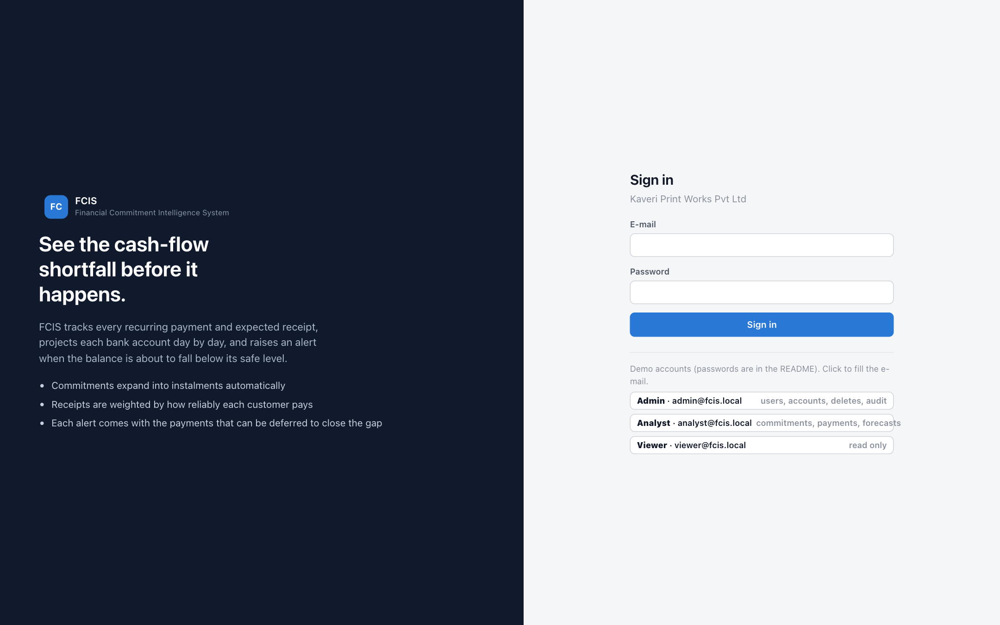{width=6.40in}


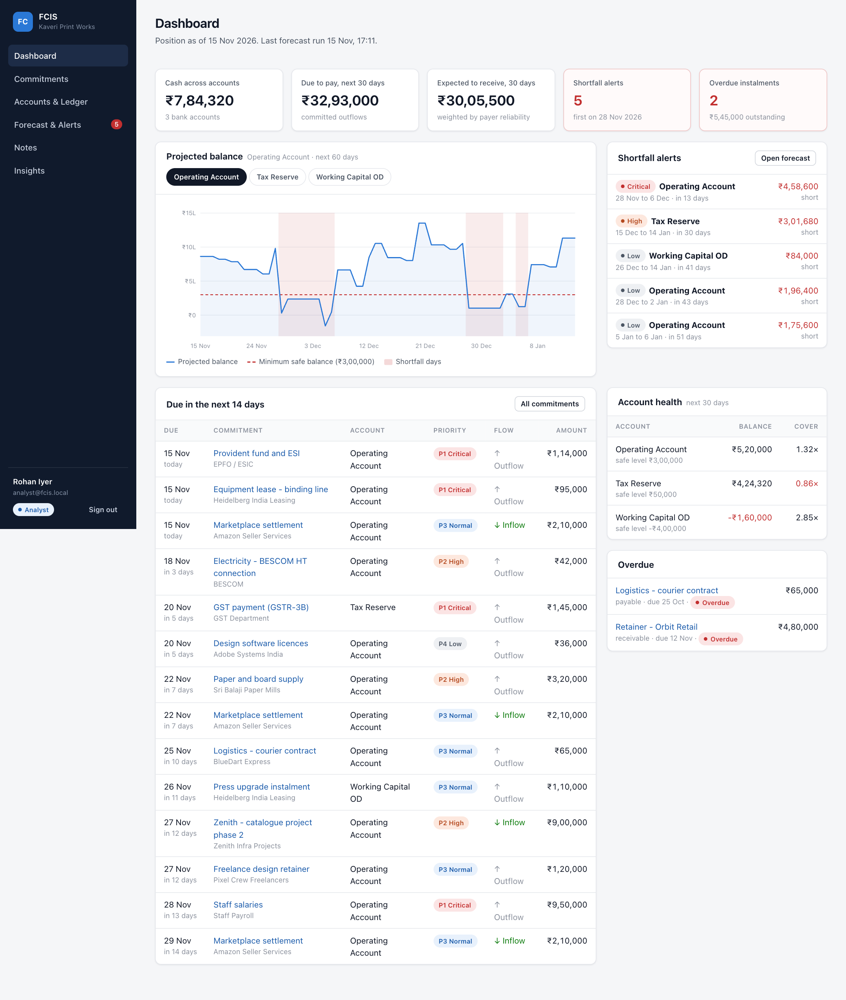{width=6.40in}


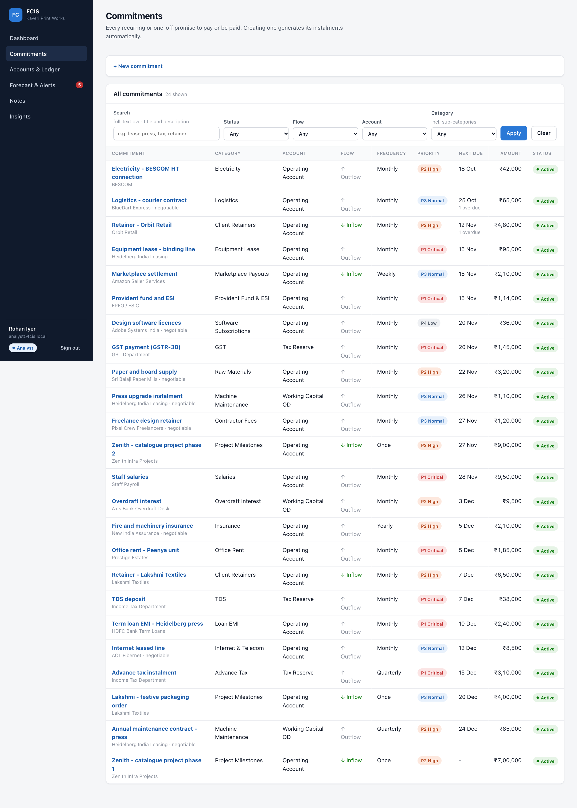{width=5.86in}


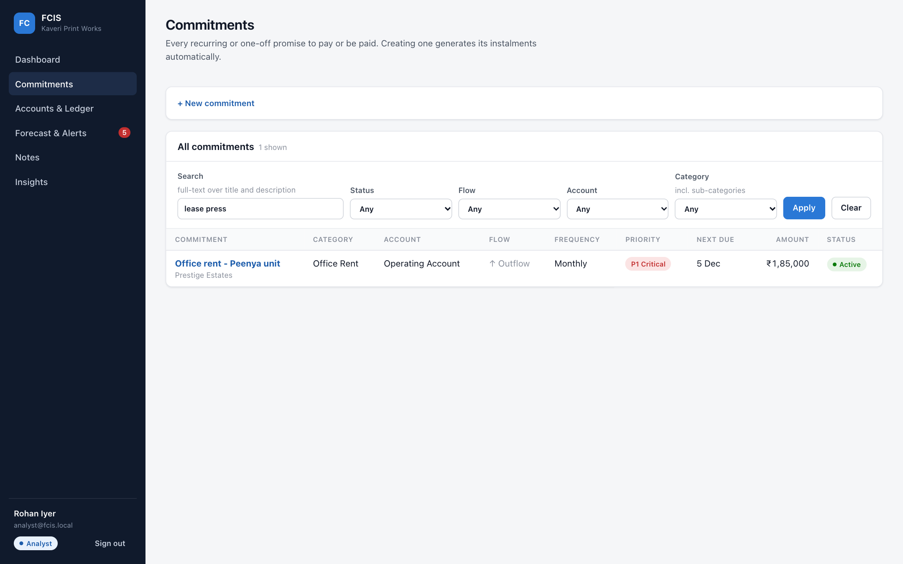{width=6.40in}


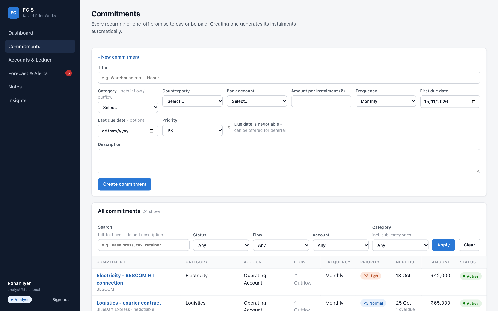{width=6.40in}


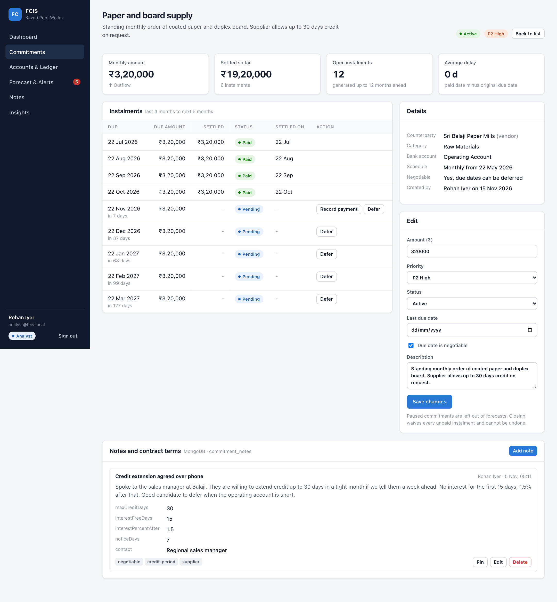{width=6.40in}


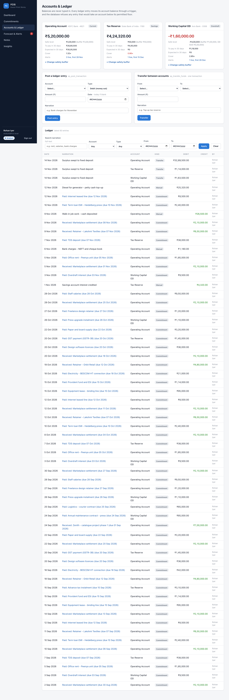{width=2.69in}


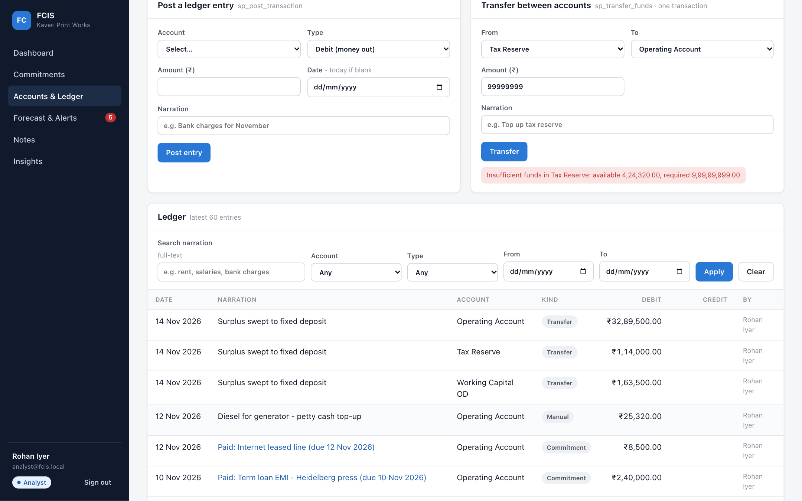{width=6.40in}


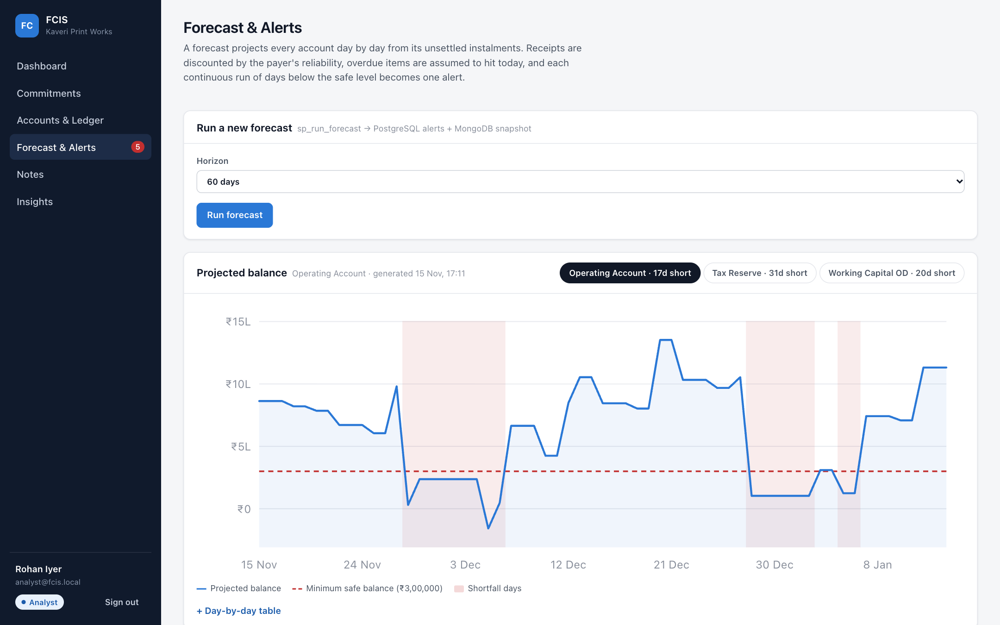{width=6.40in}


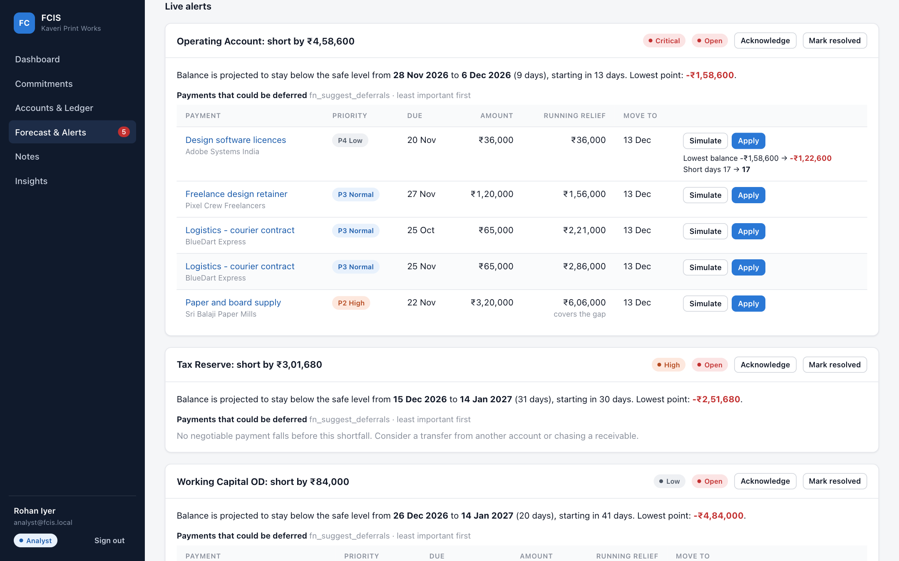{width=6.40in}


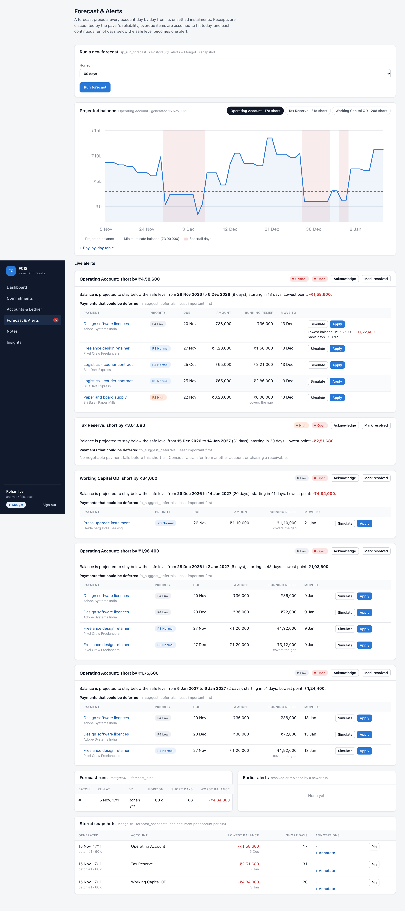{width=3.65in}


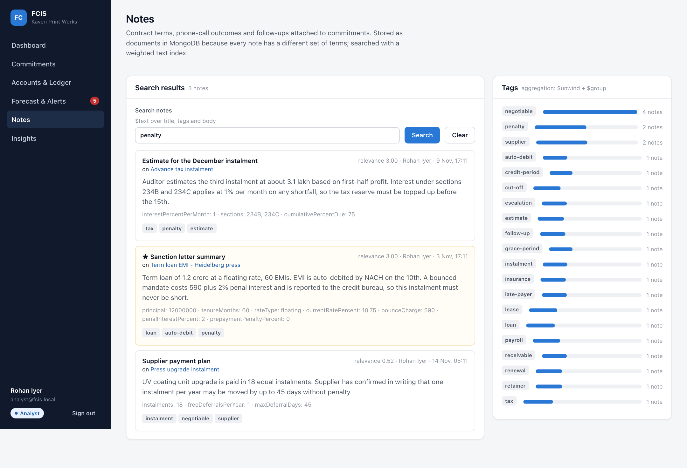{width=6.40in}


{width=1.53in}


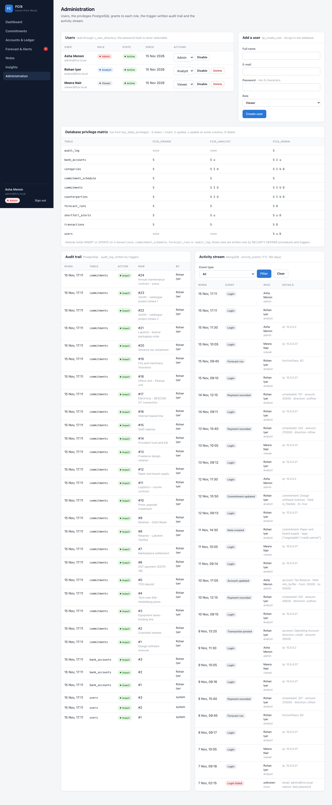{width=3.39in}


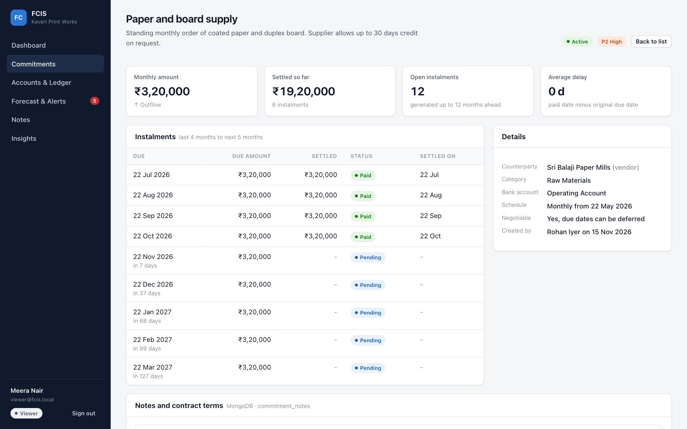{width=6.40in}


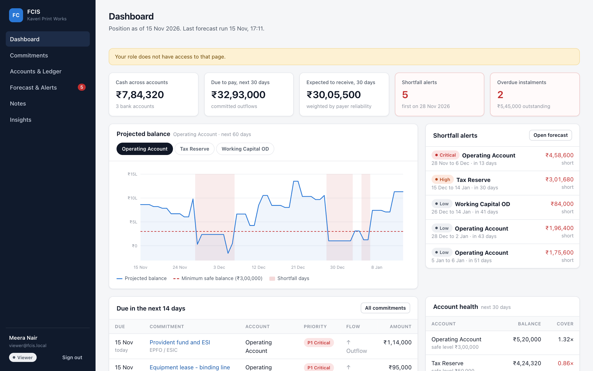{width=6.40in}


# 10. Testing results

The suite in `tests/run-tests.mjs` is run with `npm test`. Result of the latest run: **58 passed, 0 failed**.

#### Authentication

| ID | Test case | Result | Observed |
|---|---|---|---|
| A01 | fn_verify_login accepts the correct password | PASS | e-mail is trimmed and case-insensitive; returns role = analyst |
| A02 | fn_verify_login rejects a wrong password | PASS | zero rows |
| A03 | Passwords are stored as bcrypt hashes, never plain text | PASS | hash starts with $2a$10$ |
| A04 | Login role fcis_app cannot read any table before SET ROLE | PASS | permission denied (42501) on users and commitments |

#### Role-based access

| ID | Test case | Result | Observed |
|---|---|---|---|
| R01 | Viewer can read but cannot INSERT a commitment | PASS | read 24 rows; INSERT denied (42501) |
| R02 | Viewer cannot execute sp_record_payment | PASS | EXECUTE denied (42501) |
| R03 | Analyst cannot DELETE a commitment; admin can | PASS | analyst: 42501; admin: 1 row deleted, instalments cascade |
| R04 | Column-level grant: analyst may change min_buffer but not current_balance | PASS | min_buffer updated; current_balance denied (42501) |
| R05 | Nobody can write the ledger directly, not even admin | PASS | INSERT denied for analyst and admin; only procedures write transactions |
| R06 | Admin cannot select the password hash column | PASS | password_hash denied; other columns readable |
| R07 | Analyst cannot read the audit log or create users | PASS | both denied (42501) |

#### Constraints

| ID | Test case | Result | Observed |
|---|---|---|---|
| C01 | CHECK: commitment amount must be positive | PASS | ck_commitments_amount |
| C02 | CHECK: end date cannot precede start date | PASS | ck_commitments_dates |
| C03 | CHECK: unknown frequency is rejected | PASS | ck_commitments_frequency |
| C04 | UNIQUE: duplicate commitment title | PASS | uq_commitments_title |
| C05 | FOREIGN KEY: commitment must reference an existing account | PASS | fk_commitments_account |
| C06 | CHECK (regex): invalid e-mail and short password for a new user | PASS | ck_users_email, password rule, uq_users_email |
| C07 | CHECK: counterparty reliability must lie between 0 and 1 | PASS | ck_counterparty_reliability |
| C08 | FOREIGN KEY RESTRICT: a commitment with payment history cannot be deleted | PASS | fk_transactions_schedule blocks the cascade |

#### Triggers

| ID | Test case | Result | Observed |
|---|---|---|---|
| T01 | AFTER INSERT trigger generates the instalments of a new commitment | PASS | 6 rows: 2027-01-31, 2027-02-28, 2027-03-31, 2027-04-30, 2027-05-31, 2027-06-30 |
| T02 | BEFORE trigger rejects a category whose direction differs from the commitment | PASS | raised: category direction does not match |
| T03 | Recurrence rule is frozen after creation | PASS | raised: frequency, start date and direction cannot be changed |
| T04 | Changing the amount re-prices only future unpaid instalments | PASS | 12 future instalments now 40,000; 6 paid ones untouched |
| T05 | Closing a commitment waives every unpaid instalment | PASS | 12 instalments waived, 0 left open; reopening refused |
| T06 | Ledger rows are immutable (BEFORE UPDATE trigger) | PASS | even the table owner is refused |
| T07 | The last active administrator cannot be demoted, disabled or deleted | PASS | all three refused |
| T08 | Audit trigger records who changed what, with old and new values | PASS | UPDATE by user 2: priority 4 -> 5 |

#### Procedures & transactions

| ID | Test case | Result | Observed |
|---|---|---|---|
| P01 | sp_record_payment: full payment updates ledger, balance and instalment together | PASS | balance 520000 -> 484000; instalment paid; debit entry by analyst |
| P02 | sp_record_payment: part payment sets status to partial | PASS | status = partial, amount_paid = 1000 |
| P03 | sp_record_payment: over-payment and double payment are refused | PASS | both raise P0001 |
| P04 | Insufficient funds: the payment is rolled back completely | PASS | balance 520000 < 950000: refused; balance, ledger and instalment unchanged |
| P05 | sp_transfer_funds is atomic and conserves money | PASS | failed transfer changes nothing; good transfer: -150,000 / +150,000, total unchanged |
| P06 | CHECK on balance floor stops any entry below the overdraft limit | PASS | ck_account_balance_floor fires from the balance trigger |
| P07 | Deleting a ledger entry reverses the balance and reopens the instalment | PASS | balance restored, instalment back to pending |
| P08 | sp_defer_schedule: only flexible instalments, forward only, max 90 days | PASS | three invalid requests refused; valid deferral moves due_date by 20 days, original date kept |

#### Forecast

| ID | Test case | Result | Observed |
|---|---|---|---|
| F01 | fn_project_cashflow: running balance equals opening balance plus net flows | PASS | 61 calendar days from the recursive CTE; 520000 + 611200 = 1131200 |
| F02 | Inflows are weighted by the payer reliability score | PASS | invoice 900000 x reliability 0.55 = 495000.00000000006 counted |
| F03 | sp_run_forecast stores one run per account and one alert per shortfall episode | PASS | batch 2: 3 runs; alert episodes match an independent LAG() recomputation; older alerts superseded |
| F04 | What-if: deferring a suggested payment raises the lowest projected balance | PASS | 5 suggestions, least important first; moving "Paper and board supply" lifts the low point -158600 -> 161400 |

#### Queries

| ID | Test case | Result | Observed |
|---|---|---|---|
| Q01 | Recursive CTE returns every descendant of a category | PASS | 15 categories under Operating Expenses, two levels deep |
| Q02 | Full-text search uses stemming and ranks the title above the description | PASS | "leasing presses" matches 1 commitment(s), first: Office rent - Peenya unit |
| Q03 | Partial index is used for the open-instalment scan | PASS | EXPLAIN shows idx_schedule_open_due |
| Q04 | View v_account_health agrees with the base tables | PASS | outflow_30d = 2680500 both ways |
| Q05 | Ledger and balances reconcile: balance = sum(credits) - sum(debits) | PASS | 3 accounts reconcile to the paisa |

#### MongoDB

| ID | Test case | Result | Observed |
|---|---|---|---|
| M01 | $jsonSchema validator rejects a note without a title | PASS | Document failed validation (code 121) |
| M02 | Validator rejects a badly formed tag and a wrong type | PASS | tag pattern, bsonType int and uniqueItems all enforced |
| M03 | Create, read, update ($set, $addToSet, $currentDate) and delete a note | PASS | insertOne -> findOne -> findOneAndUpdate -> deleteOne |
| M04 | Text index search ranks by relevance | PASS | 4 notes; top: "Estimate for the December instalment" (score 3.52); plan uses notes_text |
| M05 | Aggregation: $unwind + $group counts tags across notes | PASS | top tag "negotiable" appears in 4 notes (matches a plain find) |
| M06 | Snapshot documents match PostgreSQL and the unique index blocks duplicates | PASS | run 1: 61 embedded days, summary equals forecast_runs; duplicate runId rejected (E11000) |
| M07 | Aggregation over the nested daily array reproduces the SQL shortfall count | PASS | 3 accounts with shortfall days; counts equal forecast_runs.shortfall_days |
| M08 | Expected indexes exist, including the TTL index | PASS | ttl_180_days (15,552,000 s), run_unique, latest_per_account, partial runs_with_shortfall |

#### HTTP API

| ID | Test case | Result | Observed |
|---|---|---|---|
| H01 | Login sets an httpOnly session cookie; a wrong password returns 401 | PASS | 401 for bad password; 200 + HttpOnly cookie for good one |
| H02 | Unauthenticated requests: API returns 401, pages redirect to /login | PASS | API 401; page 307 -> /login |
| H03 | Viewer: reads succeed, writes are refused by the database role (403) | PASS | GET 200; POST commitment 403; POST payment 403; /admin redirects away |
| H04 | Analyst creates a commitment (instalments generated), edits it; only admin can delete it | PASS | create 200 (3 instalments) -> patch 200 (re-priced) -> invalid amount 400 -> analyst delete 403 -> admin delete 200 |
| H05 | Note CRUD through the API (MongoDB) with validation | PASS | bad tag 400; viewer 403; create -> update -> find by tag -> delete |
| H06 | Admin-only endpoints refuse the analyst | PASS | analyst 403 on list and create; admin 200, no password hash in the response |


# 11. Evaluation rubrics: completion status

| # | Evaluation component | Max | Status | Evidence |
|---|---|---|---|---|
| 1 | ER diagram | 2 | Completed | Section 5.1, `docs/er-diagram.png`: 10 entities, attributes, primary keys, 14 relationships with cardinalities, one recursive |
| 2 | Relational schema with keys, relationships and constraints | 3 | Completed | Sections 5.2 and 5.3: primary, foreign and candidate keys, referential actions, all CHECK constraints, normalisation |
| 3 | SQL database implementation, DDL with constraints | 4 | Completed | Section 6.1: CREATE (tables, sequence, indexes, extension), ALTER (add column, add / drop constraint, change type, generated column), DROP (index, table, constraint), PK, FK, UNIQUE, NOT NULL, DEFAULT, CHECK |
| 4 | NoSQL database creation | 4 | Completed | Sections 5.4 and 7: three MongoDB collections with `$jsonSchema` validators and nine indexes (compound, multikey, text, unique, partial, TTL) |
| 5 | Technology justification | 1 | Completed | Section 4.1 |
| 6 | DML operations | 4 | Completed | Section 6.7 part A and the application: INSERT, INSERT ... SELECT, UPDATE, UPDATE with subquery, DELETE, SELECT, all reachable from the interface |
| 7 | Nested, correlated, recursive and join queries | 4 | Completed | Section 6.7 parts B to E and the Insights page: 5-table join, left / self / lateral joins, nested, correlated, EXISTS, ALL, recursive CTEs |
| 8 | Advanced SQL concepts (procedure / function, trigger, CTE) | 6 | Completed | Sections 6.2 to 6.4: 9 procedures, 6 functions, 13 triggers, recursive CTEs, window functions, views, transactions, full-text search, partial and GIN indexes |
| 9 | NoSQL feature, read / update / delete | 7 | Completed | Section 7 and the application: note CRUD, snapshot annotate / pin / delete, text search, five aggregation pipelines, schema validation |
| 10 | Next.js interface | 3 | Completed | Section 9.2: dashboard, forms, tables, search, filters, chart, nine pages |
| 11 | Backend / API and database integration | 2 | Completed | 24 route handlers; credentials only in environment variables; one transaction per request |
| 12 | Authentication, two or more roles, role-based access control in the database | 4 | Completed | Section 6.5: login verified in PostgreSQL; three application roles mapped to PostgreSQL roles with table and column-level grants; tests R01 to R07 and H01 to H06 |
| 13 | Documentation, Git / GitHub | 2 | Completed | This report, `README.md`, `docs/`; repository at https://github.com/vishalprasath/dbms-miniproject-fcis |
| 14 | Originality, individual contribution, modification / viva | 4 | Contribution documented; viva to be demonstrated by the team | Section 12 |

# 12. Individual contribution

The work was divided so that each member owns a complete slice of the system, from the database objects to the
pages that use them, and both members worked on the database and on the application.

| Area | Vishal Prasath (PES1UG24CS536) | Vibha Vasisht (PES1UG24CS526) |
|---|---|---|
| Database design | ER diagram; relational schema; normalisation and referential actions | Data dictionary; MongoDB data model and retrieval strategy; technology justification |
| SQL implementation | DDL in `01_schema.sql`: tables, keys, CHECK constraints, ALTER and DROP, indexes and full-text search | Views in `04_views.sql`; roles, table and column-level grants in `05_roles.sql`; seed data in `06_seed.sql` |
| Advanced SQL | Procedures for payments, transfers, ledger entries and deferrals; forecasting functions `fn_project_cashflow`, `sp_run_forecast`, `fn_suggest_deferrals`; ledger and balance triggers | Instalment generation, status, commitment guard, last-admin guard and audit triggers; login and user procedures (`fn_verify_login`, `sp_create_user`); analytical queries in `07_queries.sql` |
| NoSQL (MongoDB) | `forecast_snapshots` collection: snapshot builder, validator, indexes, annotate / pin / delete | `commitment_notes` and `activity_events` collections: validators, text and TTL indexes, note CRUD, aggregation pipelines |
| Backend / API | Database access layer with per-request `SET ROLE` (`src/lib/db.js`, `src/lib/api.js`); routes for payments, transfers, ledger, accounts, forecast and alerts | Authentication and sessions (`src/lib/auth.js`, `/api/auth`); routes for commitments, notes, snapshots, users and counterparties |
| Next.js interface | Dashboard, Accounts & Ledger, Forecast & Alerts pages; balance chart; deferral simulation | Login, Commitments list and detail, Notes, Insights and Administration pages; notes panel |
| Testing and documentation | Procedure, transaction and forecast test cases; README setup instructions | Constraint, trigger, role, MongoDB and API test cases; project report, ER diagram rendering and screenshots |

# 13. Conclusion

FCIS shows that early warning of a cash-flow shortfall is largely a database problem. Once commitments are stored
with a recurrence rule and expanded into instalments, the projection of a balance is a join, an aggregation and a
running total, which PostgreSQL computes directly with a recursive CTE and a window function. Placing the rules in
the database, as constraints, triggers, procedures and role grants, means they hold for every client: the test
suite confirms that even the table owner cannot edit a ledger row and that no role can write to the ledger except
through a procedure.

Using two databases was justified by the data. The relational model gave atomic payments and referential
integrity; the document model gave flexible contract terms, a compact store for nested forecast curves and
self-expiring activity records. The two are joined by keys and kept consistent by writing the snapshot inside the
relational transaction.

Possible extensions are learning the reliability score of each payer from its payment history instead of setting
it by hand, importing bank statements to match receipts automatically, sending alert notifications by e-mail, and
supporting several organisations with row-level security.
